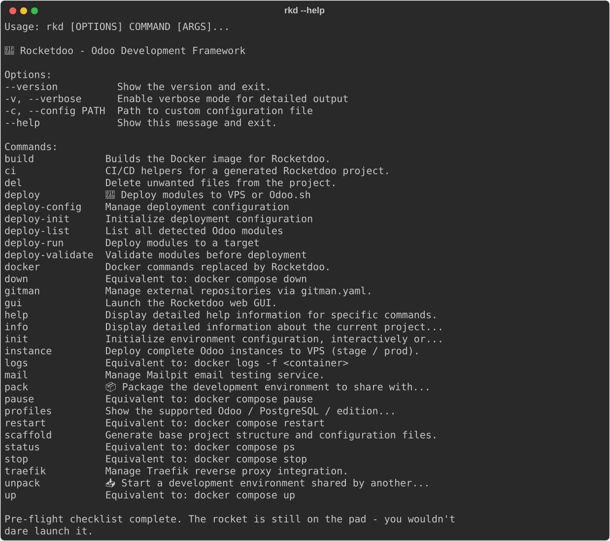
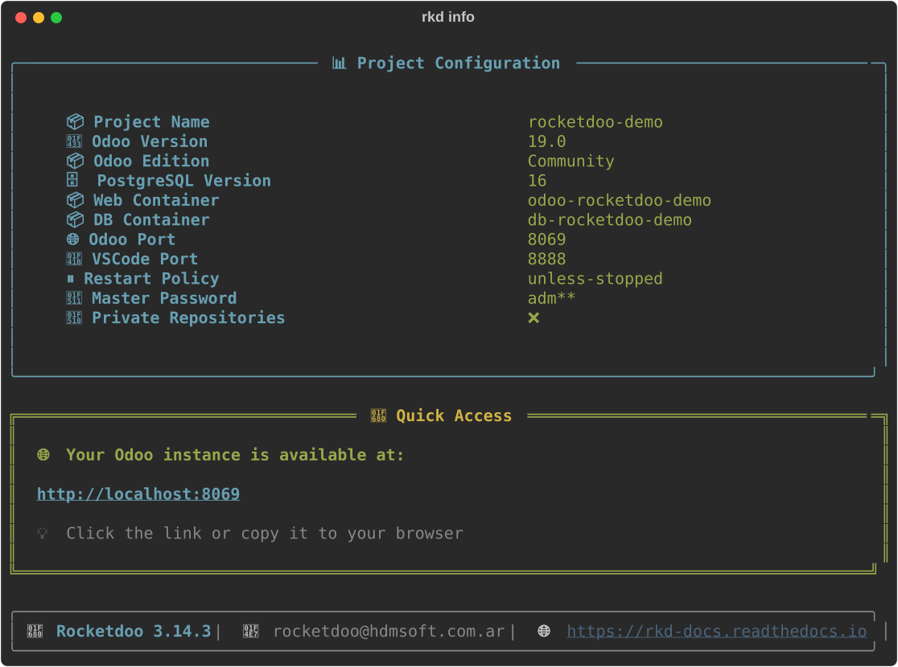
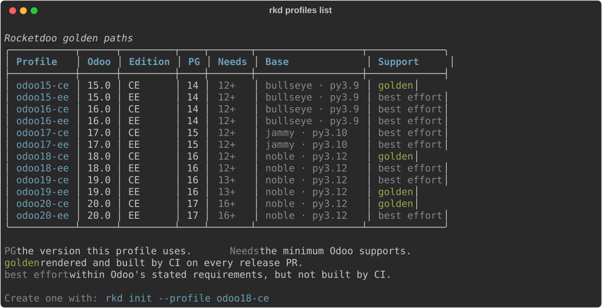
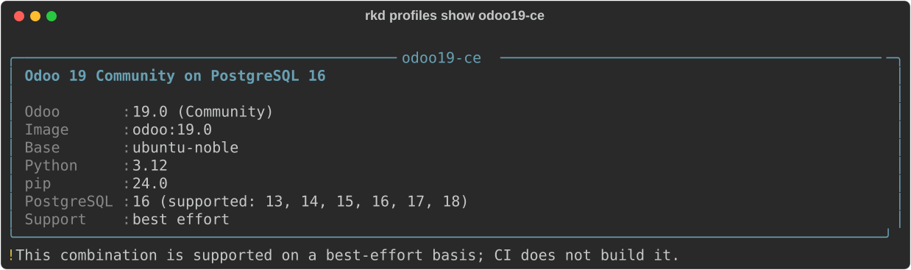
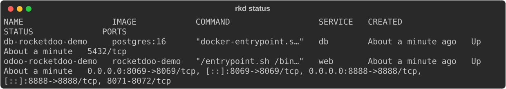
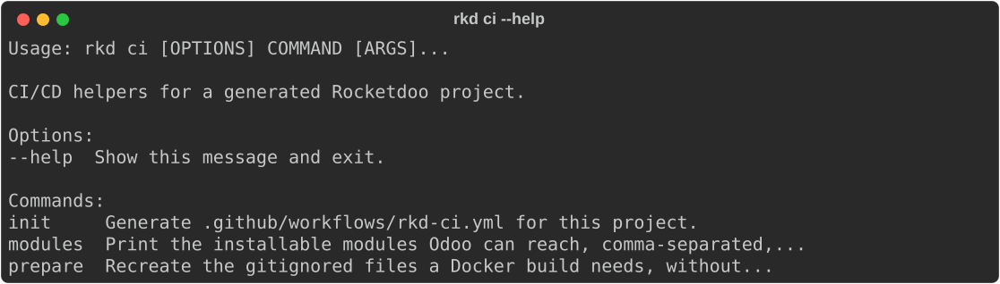
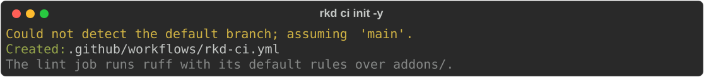
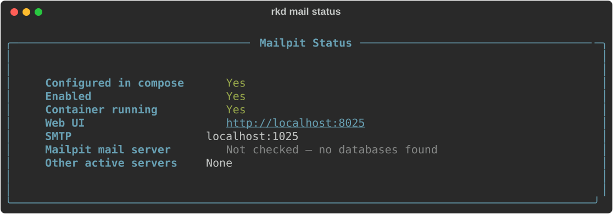
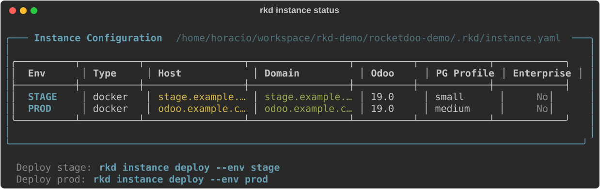

# Command Line Interface

Here are the most common commands you can use in **RKD** **ROCKETDOO**.

> You can use either `rocketdoo` or the shorter alias `rkd` — both are equivalent.

> **TIP:** Combine any command with `--help` to see its flags and options.  
> Example: `rkd build --help`

---

## General

* Display Rocketdoo version:

~~~
rkd --version
~~~

* Display help and available commands:

~~~
rkd --help
~~~

---

## Project Setup

* Generate the directory and file structure:

~~~
rkd scaffold
~~~

* Launch the initialization wizard:

~~~
rkd init
~~~

* Or create the environment straight from a supported profile, with no questions asked:

~~~
rkd init --profile odoo18-ce
~~~

* Display detailed information about the current project:

~~~
rkd info
~~~

> Since 3.5, `rkd info` also warns when a module under `addons/` sits in a subdirectory that Odoo's
> `addons_path` does not cover. It only warns, never writes. What writes the path: `rkd up`,
> `rkd restart`, `rkd build --rebuild`, `rkd ci prepare`, the GUI's Up and the per-module update.

---

## Golden Paths (`rkd profiles`)

> **New in 3.2, extended in 3.7.** A *golden path* is a named, supported combination of Odoo
> version, edition and PostgreSQL version. Rocketdoo ships twelve of them — Odoo 15 to **20**,
> Community and Enterprise — and they are the source of truth for both the `rkd init` wizard and
> `rkd init --profile`.

* List the whole matrix:

~~~
rkd profiles list
~~~

* Show the details of a single profile:

~~~
rkd profiles show odoo19-ce
~~~

* Create that environment end to end, without the wizard:

~~~
mkdir my-project && cd my-project
rkd scaffold
rkd init --profile odoo18-ce
rkd up -d
~~~

### Support levels

| Level | What it means |
|---|---|
| **golden** | CI renders **and builds** this combination on every release PR. These are the ones to choose. |
| **best effort** | Within Odoo's stated requirements and offered by the wizard, but not built by CI. Reports are welcome, but there is no guarantee. |

The golden combinations today are `odoo15-ce`, `odoo18-ce`, `odoo19-ee` and `odoo20-ce`: between
them they cover the three different base images the `odoo:` images use, both editions, and the
current release.

### Compatibility matrix

Per-image data was read from the published `odoo:` images; the PostgreSQL minimums come from Odoo's
own installation documentation.

| Odoo | Base | Python | pip | Minimum PostgreSQL | Recommended |
|---|---|---|---|---|---|
| 15.0 | debian-bullseye | 3.9 | 20.3.4 | 12 | 14 |
| 16.0 | debian-bullseye | 3.9 | 20.3.4 | 12 | 14 |
| 17.0 | ubuntu-jammy | 3.10 | 22.0.2 | 12 | 15 |
| 18.0 | ubuntu-noble | 3.12 | 24.0 | 12 | 16 |
| 19.0 | ubuntu-noble | 3.12 | 24.0 | **13** | 16 |
| 20.0 | ubuntu-noble | 3.12 | 24.0 | **16** | 17 |

Odoo 19 raised the PostgreSQL minimum from 12 to 13, and **Odoo 20 raised it again to 16** — the
biggest jump in the series. Rocketdoo validates the pairing when the profile is loaded: a
`db_version` below the minimum for that Odoo version is an error, not a warning, so the wizard can no
longer produce an environment that will not start.

> **Moving an existing project to Odoo 20.** Because the image shares its base with 18 and 19, the
> generated `Dockerfile` needs no change — but a project sitting on PostgreSQL 14 or 15 cannot simply
> switch versions. Migrate the database to 16 or newer first; the matrix now refuses the pairing
> instead of letting it through and failing at startup.

> **Odoo 19 and AI:** Odoo 19's AI features need the `pgvector` extension, which ships for
> PostgreSQL 15 and above. `rkd profiles show odoo19-*` warns you when the profile uses a lower version.

> **Enterprise:** any `*-ee` profile expects an `./enterprise` directory with the Odoo Enterprise
> add-ons (subscription required) next to `addons/` before you run `rkd up -d`.

---

## Container Management

* Deploy Odoo (start containers in detached mode):

~~~
rkd up -d
~~~

* Check the status of your containers:

~~~
rkd status
~~~

* Stop all containers:

~~~
rkd stop
~~~

* Restart the containers:

~~~
rkd restart
~~~

* Remove containers:

~~~
rkd down
~~~

* Remove containers and their associated volumes:

~~~
rkd down -v
~~~

* Force environment rebuild:

~~~
rkd build
~~~

* Build and restart containers in one step:

~~~
rkd build --rebuild
~~~

* View container logs:

~~~
rkd logs
~~~

* Follow logs in real-time for a specific container:

~~~
rkd logs <container_name> -f
~~~

---

## Environment Sharing

* Package your entire environment to share with other developers:

~~~
rkd pack                   # full environment + database backup + filestore
rkd pack --no-db           # environment files only
rkd pack -o /tmp/my.zip    # choose the output path
rkd pack --db-name demo    # pick the database, when the project has several
rkd pack --yes             # no prompt: continue without a backup if the DB container is down
~~~

* Unpackage a shared `.zip` project into your directory:

~~~
rkd unpack                 # full setup: ports, SSH, database restore
rkd unpack --build         # rebuild the Docker image first (recommended on a first run)
rkd unpack --no-restore    # skip the database restore
rkd unpack --ssh-key NAME  # use this key from ~/.ssh/ instead of asking
rkd unpack --no-ssh        # the project has no private repositories
rkd unpack --yes           # accept the suggested fixes for port conflicts
~~~

### What never enters the ZIP

> **Since 3.9.2.** `rkd pack` used to hand the sender's own credentials to whoever received the file.

The archive leaves out `.ssh/`, `.rkd/secrets/`, `.rkd/instance.yaml`, `.rkd/deploy.yaml`,
`traefik/certs/acme.json` and every `*.env` (except `*.env.example`), and **no symbolic link enters
it** — a link pointing at a secrets file used to carry that file out of the project. Hard links are
caught by inode. It also drops `.rkd/deploy_backups`, which holds the sender's own backup history and
is of no use to anybody else. The closing panel names everything that was left out, which is exactly
the list the receiver has to rewrite on their side.

> **Two credentials do travel, on purpose.** `odoo_pg_pass` and `config/odoo.conf` are packed,
> because without them the shared environment does not start: Compose mounts the first as a Docker
> secret and the Dockerfile copies the second at build time. They are the local credentials of the
> environment being handed over, which is the point of the ZIP — so treat a Rocketdoo archive as
> something you send to a teammate, not something you publish.

Since 3.10 the verifier reads the first 64 KiB of each entry looking for PEM headers instead of
trusting filenames, and separates the two cases: a **red** warning when a file Rocketdoo declares
secret slipped in, and a calmer **amber** one when something merely reads like a private key — an
Enterprise project typically carries about five of those, from Odoo's own localizations.

The ZIP also no longer packs itself, nor the backups left by previous packs (3.8.1).

### A restored copy gets its own Compose identity

> **Since 3.9.** When the Compose project name in the archive is already used by another directory on
> your host, `rkd unpack` renames the copy instead of colliding with the original.

Two copies sharing one project name meant Compose treated the original's containers as belonging to
the copy — recreating and destroying them — and the restore ran `DROP DATABASE` against the
original's data. The rename is all-or-nothing and covers `name:`, `image:`, every `container_name`
(including the commented Mailpit one), volume definitions and references, and `db_host` in
`config/odoo.conf`.

Detection asks `docker compose ls` **and** looks at volume labels, because a project brought down
with `rkd down` (no `-v`) is absent from the first while its volumes are still on disk. If Docker
does not answer, nothing is renamed: Rocketdoo never guesses. The CLI asks — `Rename this copy to
<suggested>?` — `--yes` accepts, and the GUI accepts automatically.

The copy also takes its own ports when the original holds them, and the message distinguishes "this
port is in use" from "this port belongs to the other copy, which is switched off".

---

## Utilities

* Delete `.Identifier` files generated by WSL2 when copying files from Windows:

~~~
rkd del -i
~~~

* Preview which files would be deleted (dry run, no files removed):

~~~
rkd del -i --dry-run
~~~

* Bulk update module packages loaded as public repositories using Gitman:  
(This command must be executed inside the container.)

~~~
gitman update
~~~

### One command that is not in `--help`

> **New in 3.10.** The epilogue of `rkd --help` ends with a line about a rocket still on the pad.
> It is a hint.

~~~
rkd launch
~~~

A rocket climbs a field of stars on the terminal's alternate screen — like `vim` or `less`, so your
scrollback is left alone — and the flight ends on one of six lines of the "Zen of Odoo" about
customizing with Studio. The animation is skipped without a TTY, with `TERM` set to `dumb` or
`unknown`, or on a terminal smaller than 25×13, but **the message is printed anyway**, so
`rkd launch | cat` still reads. It respects `NO_COLOR`.

---

## ⚙️ Continuous Integration (`rkd ci`)

> **New in 3.5.** `rkd ci` writes a GitHub Actions workflow **for your project** — not for
> Rocketdoo. It lints your addons and, optionally, installs them against a real Odoo.

* Generate `.github/workflows/rkd-ci.yml`:

~~~
rkd ci init
~~~

On a terminal this **asks you when the install job should run**, defaulting to `pull_request`.
Answer up front, or skip the question entirely:

~~~
rkd ci init -y                              # take the default, no question
rkd ci init --install-trigger never         # lint only
~~~

| Option | Description |
|--------|-------------|
| `--install-trigger` | When the install job runs: `pull_request`, `push`, `manual`, `never`. Asked interactively if omitted; `pull_request` without a terminal |
| `--force` | Overwrite a workflow that differs from the current render |
| `-y, --yes` | Skip the install-trigger question and take the default |

It never overwrites a file that differs from what it would write, without `--force`, whether the
difference came from you editing it by hand or from a config change. What it tells you: `Created:`
for a new file, *already up to date* when it matches, a warning naming `--force` when it differs,
and `Overwritten:` when you pass it.

* Regenerate the files a clean clone does not carry:

~~~
rkd ci prepare
~~~

`config/odoo.conf` and `odoo_pg_pass` are gitignored — they hold credentials — so a fresh clone does
not have them. The build copies `config/odoo.conf` into the image (`COPY ./config/odoo.conf`) and
compose feeds `odoo_pg_pass` in as a secret at startup, so without this step a clean checkout gets
nowhere. It also syncs the `addons_path`. It never overwrites an `odoo.conf` that already exists,
which is what the output above is reporting.

Pass `--admin-passwd` to set the master password it writes; otherwise one is generated.

* List the installable modules Odoo can actually reach:

~~~
rkd ci modules
~~~

Prints them comma-separated on stdout, for `MODULES=$(rkd ci modules)` inside the workflow.

### What the generated workflow does

| Job | When it runs | What it costs |
|-----|--------------|---------------|
| **Lint** | Every pull request, pushes to the default branch, and manually | Seconds |
| **Install** | Pull requests against the default branch, by default | Several minutes |

The workflow triggers on `pull_request`, on `push` **to the default branch only**, and on
`workflow_dispatch`. Pushing a feature branch with no pull request open runs nothing. The lint job
runs `ruff check` over `addons/` and then `rkd deploy validate -p addons`.

The install job is the expensive one, which is why it is limited by default. On **private** repos
the Free plan gives 2,000 Actions minutes a month shared across your whole account; **public** repos
do not consume that quota. Change the trigger with `--install-trigger` if that split does not suit
you.

> Those numbers are GitHub's, not Rocketdoo's, and GitHub changes them:
> [check the current Actions billing](https://docs.github.com/en/billing/managing-billing-for-github-actions/about-billing-for-github-actions).

**Manifest linting.** Ruff's default rules flag `B018` on every `__manifest__.py` — by Odoo's own
definition it is a bare dict literal — so the generated workflow passes
`--extend-per-file-ignores "**/__manifest__.py:B018"`. Without it the lint job is red on every Odoo
project.

> `rkd ci init` signs off with *"the lint job runs ruff with its default rules"*. The generated
> workflow does add the exception above — the message is the thing that is imprecise, not the
> workflow.

### What is outside the generated path

- **Enterprise, and private repos over SSH.** The workflow is still written, without the install job
  and with the reason as a comment: a runner has no access to your private sources.
- **Private Gitman sources.** `rkd ci init` warns if `gitman.yaml` has `git@`/`ssh://` sources, but
  it cannot tell a private HTTPS repo from a public one — that build fails on the runner with no
  warning up front.
- **Deploying to staging.** Deliberately left out for now: `rkd deploy` has no headless way to
  generate a `deploy.yaml`, so the generated workflow only lints and installs.

---

## 📧 Mail — Mailpit Email Testing (`rkd mail`)

Mailpit is a local SMTP server and web UI that captures all outgoing emails from Odoo instead of actually sending them. Ideal for testing email workflows without affecting real users.

* Enable Mailpit (start service + configure Odoo SMTP automatically):

~~~
rkd mail on
~~~

* Disable Mailpit and restore default SMTP settings:

~~~
rkd mail off
~~~

* Check the current Mailpit status:

~~~
rkd mail status
~~~

* Open the Mailpit web interface in the browser:

~~~
rkd mail open
~~~

### Mailpit picks a free host port

> **Since 3.9.1.** The host ports are no longer fixed at 1025 and 8025, so two Rocketdoo projects
> with Mailpit enabled no longer collide.

`rkd mail on` reads the ports declared in the compose file, keeps them when they are free, and takes
the next free one when they are not — counting ports declared by a sibling project that is currently
switched off, not only ports in use right now. It prints which ones it took and writes them back into
the compose file when you turn Mailpit off, so a browser bookmark keeps working.

`rkd mail open` and `rkd mail status` read the real published port rather than assuming 8025, which
is why the status panel is the place to look for the web UI address.

**The internal port never changes.** Inside the Docker network Odoo always talks to `mailpit:1025`;
only the host side moves.

### The mail server record in Odoo

> **New in 3.3.** On top of the compose and `odoo.conf` toggle, `on`/`off`/`status` now read and
> write an `ir.mail_server` record in your database, named **`Mailpit (rkd)`**, with
> `smtp_host = mailpit` and `sequence = 1`. Before this, enabling Mailpit configured the transport
> but left Odoo still pointing at whatever mail server the database had.

`off` only archives the record (`active = false`) — it never deletes, so a mail server of your own
is never at risk. The record is matched by name plus `smtp_host`: if you rename it by hand, `off`
will not find it (and says so) and `on` will create a new one.

**Multi-database projects need `--db`:**

~~~
rkd mail on --db my_database
rkd mail status --db my_database
rkd mail off --db my_database
~~~

With exactly one database in the project it is picked automatically. With two or more and no
`--db`, the command neither reads nor writes the record, and tells you.

The `db` container has to be up for this part. If it is not, the compose and `odoo.conf` toggle
still happens and the mail server step is reported as not done — run `rkd up -d` and retry the same
command.

> **Known limit.** `sequence = 1` does not guarantee Mailpit wins. Odoo filters mail servers by
> `from_filter` *before* ordering by `sequence`, so another active server whose `from_filter`
> matches the sender can beat Mailpit anyway. `rkd mail status` warns when other active servers
> exist, but it does not read or write `from_filter`.

---

## 🌐 Traefik Reverse Proxy (`rkd traefik`)

Traefik allows you to expose your local Odoo instance using a custom domain, both for local development (HTTP) and production environments (HTTPS with Let's Encrypt).

* Enable Traefik for this project (interactive wizard — prompts for domain and mode):

~~~
rkd traefik on
~~~

* Enable with specific options:

~~~
rkd traefik on --domain myproject.local --mode local
rkd traefik on --domain myproject.com --mode production --email ops@example.com
~~~

> **`--email` was added in 3.11.** With `--domain`, `--mode`, `--traefik-dir` and `--email` the
> wizard runs unattended, which is what a script or a CI job needs.

* Disable Traefik for this project (restores direct port access):

~~~
rkd traefik off
~~~

* Show Traefik integration status:

~~~
rkd traefik status
~~~

* Show step-by-step guide to configure local domains (`/etc/hosts` and WSL2):

~~~
rkd traefik guide
~~~

> Traefik modes:
> - **local** — HTTP only, custom domain via `/etc/hosts`.
> - **production** — HTTPS with automatic Let's Encrypt certificate.

> **`off` only removes the override.** Your `docker-compose.yaml` is never touched, so reconfiguring
> means `rkd traefik off` and then `on` again. When `.rkd/instance.yaml` exists, `rkd traefik status`
> also points at [`rkd instance traefik`](#installing-traefik-on-the-vps), which is the remote
> counterpart of this command.

This command configures the proxy **on your machine**. To install Traefik on the server an
environment deploys to, see [Installing Traefik on the VPS](#installing-traefik-on-the-vps).

---

## 🚀 VPS Instance Deployment (`rkd instance`)

The `instance` command deploys a complete Odoo instance to a VPS. It supports two deployment types:

- **docker** — transfers Dockerfile + compose files and builds on the VPS.
- **native** — installs Odoo via official apt packages on the server.

> **Since 3.13, the choice is about packaging, not about what you get.** Both paths install the
> Gitman repositories in the same place and build the same canonical `addons_path` —
> `enterprise, extra-addons, nested directories, gitman`. Until 3.13 the native path put Enterprise
> last and ignored nested directories.

* Configure stage/production environments interactively (saves to `.rkd/instance.yaml`):

~~~
rkd instance init
~~~

> **The wizard adds, it no longer replaces (3.11).** Each environment is offered separately —
> `Reconfigure stage?`, `Configure a prod environment?` — and whatever you do not touch is kept
> exactly as it was. Reconfiguring `stage` used to delete `prod`. The deployment type is asked once
> and applies to new environments; an existing one keeps its own. A summary at the end reports each
> environment as `added`, `kept`, `updated` or `removed`.

* Start over, dropping whatever you do not configure again:

~~~
rkd instance init --force
~~~

### What the wizard asks

Per environment: deployment type, VPS host, SSH port and user, authentication (an SSH key chosen
from `~/.ssh/`, or the name of an environment variable holding a password), Odoo version, and — for
Docker — image tag, domain, Let's Encrypt email, PostgreSQL version, database user and name. Then the
master password, the **source database** (see below), whether to use Enterprise and how it should
reach the server, whether to use Gitman, the resource profile (`small` for a VPS under 2 GB RAM,
`medium` for 4–8 GB, `large` for 16+) and the remote path.

> **Enterprise reaches the server two ways (3.11).** `rsync` transfers your local `enterprise/`
> directory; `clone` fetches `odoo/enterprise` on the VPS through a **forwarded SSH agent**, so no
> credential is left on the server. Before 3.11 choosing Enterprise declared the directory in the
> Dockerfile, the compose file and both `addons_path` entries — and put it nowhere, so Odoo started
> without the add-ons.

> **Rocketdoo refuses to write here if this is not a Rocketdoo project** (no `Dockerfile` and
> `docker-compose.yaml` side by side), because the wizard stores credentials under `.rkd/`.

### Seeding an environment with a local database

> **New in 3.14.** By default a deployed environment starts from a fresh database. The wizard also
> offers `Restore local database '<name>' (with its filestore)` for each database it finds, and the
> deploy then dumps it, transfers it, restores it on the server and neutralizes it.

It happens **once per environment**: the deploy writes a `rkd.seeded_from` mark inside the restored
database and a redeploy never restores again. To seed a second time you have to drop the database on
the VPS by hand — deliberately so, because the alternative is a flag that overwrites a client's
production with a development dump. A database the target already serves and Rocketdoo did not seed
is never overwritten: the deploy refuses and says so.

Neutralization differs by target. Both regenerate the database UUID and disable the Mailpit mail
server, which points at a host that does not exist on the VPS — leaving it would make every outgoing
mail fail silently. **Staging only** also disables scheduled actions, mail servers and payment
providers; doing that to production would stop the crons of the instance you are launching.

The admin password of a seeded database is not replaced — its users keep theirs — and the closing
panel says so instead of promising a new one.

### The pre-flight, and a dry run that writes nothing

> **Since 3.11.** Both deployers open with a pre-flight: a single read-only SSH session that collects
> facts about the server and sorts them into **blockers** and **warnings**. A blocker stops the
> deploy before anything is written.

The checks: `vps connection`, `docker`, `sudo`, `remote path`, `disk space`, `memory`,
`ssh key file`, `ssh agent`, `ssh agent socket`, `gitman file`, `gitman repositories`,
`gitman dependency script`, `enterprise directory`, `enterprise repository`, `postgresql version`,
`database identifiers`, `native host`, `seed database`, `traefik` and `public url`. Seeding adds two
blockers of its own — the source database must still exist, and a dump from a PostgreSQL newer than
the server's will not restore — and raises the disk space floor by twice the size being seeded.

`--dry-run` used to print "Deployment successful" without touching the VPS, while still writing a
secrets file locally. It now runs that same pre-flight, connects only to read, **writes nothing**,
and exits non-zero when something blocks — so this chain finally means what it looks like:

~~~
rkd instance deploy --env prod --dry-run && rkd instance deploy --env prod
~~~

* Deploy to the staging environment:

~~~
rkd instance deploy --env stage
~~~

* Deploy to production (with confirmation prompt):

~~~
rkd instance deploy --env prod
~~~

* Deploy to production skipping the confirmation:

~~~
rkd instance deploy --env prod --yes
~~~

* Run the pre-flight without deploying (dry run):

~~~
rkd instance deploy --env prod --dry-run
~~~

> **Confirmations.** `Deploy <env> to <host>?` defaults to no, `prod` adds a warning, and an
> environment configured to be seeded asks again — on `prod` you have to type `prod` literally.

* Show status of all configured deployment targets:

~~~
rkd instance status
~~~

### Installing Traefik on the VPS

> **New in 3.12.** The Odoo container only exposes its port. Something has to answer on 80 and 443
> and obtain the certificate, and that is Traefik.

~~~
rkd instance traefik --env prod
rkd instance traefik --env stage --traefik-dir /opt/traefik --email ops@example.com
~~~

It installs Traefik on that environment's server — once per host — with the same configuration `rkd
traefik` renders locally, reading `host`, `user` and the Let's Encrypt address from
`.rkd/instance.yaml`. Running it again is safe: files you tuned and certificates already issued are
kept, and an installation of your own is respected and reported rather than replaced. It exits with
an error when ports 80/443 are held by something else, or when nothing ends up serving that Odoo.

Native environments are refused: they have no reverse proxy in front today.

**The deploy never runs it for you.** Ports 80 and 443 belong to the host, not to one project, so
installing a proxy there is a decision you make once, explicitly.

> **The closing panel no longer claims a URL it did not test (3.12).** After deploying, Rocketdoo
> probes the domain from the VPS over HTTP and HTTPS and distinguishes four outcomes: Odoo answers,
> Traefik answers but cannot reach Odoo, the certificate was not issued, or nothing answers. When
> nothing answers it names `rkd instance traefik --env <env>` as the fix. A native deploy promises
> `http://<host>:8069` and says plainly that there is no reverse proxy yet.

---

## 🖥️ Graphical User Interface (`rkd gui`)

Launch the Rocketdoo web GUI in your browser. Provides full container management, live logs, mail, deploy, and more — all without typing commands.

* Start the GUI on the default port (8070):

~~~
rkd gui
~~~

> **Since 3.4, read the URL it prints.** Every run generates a session token and the GUI does not
> load without it: `http://127.0.0.1:8070/?token=<token>`. Restarting `rkd gui` issues a new one.
> See [Graphical Interface (GUI)](gui.md#the-session-token).

> **Since 3.8, reaching it without the token is not a dead end.** `http://localhost:8070` on its own
> — which is where the VSCode port notification sends you — now shows a card with a field to paste
> the token into, and the browser tab remembers the last one that worked.

> **Since 3.8, an occupied port fails honestly.** `rkd gui` used to print the full panel with a
> freshly minted token and the bind error underneath; copying that newer URL got you a 401, because
> only the server that is actually listening knows its own token. It now checks the bind before
> printing anything, explains that the URL which works is the one the other session printed, offers
> a free port, and exits with an error.

* Start the GUI on a custom port:

~~~
rkd gui --port 9090
~~~

* Start the GUI and open the browser automatically:

~~~
rkd gui --open
~~~

* Start the GUI for a project in a specific directory:

~~~
rkd gui --cwd /path/to/project
~~~

> The GUI is available at `http://localhost:8070` by default — **on the tokenised URL it prints**.
> Press `Ctrl+C` to stop it.

>>> [Learn more about the GUI](gui.md)