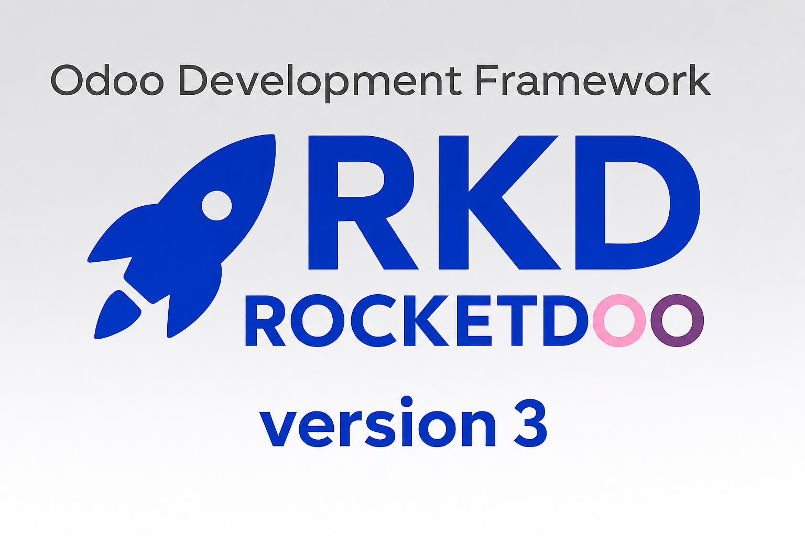
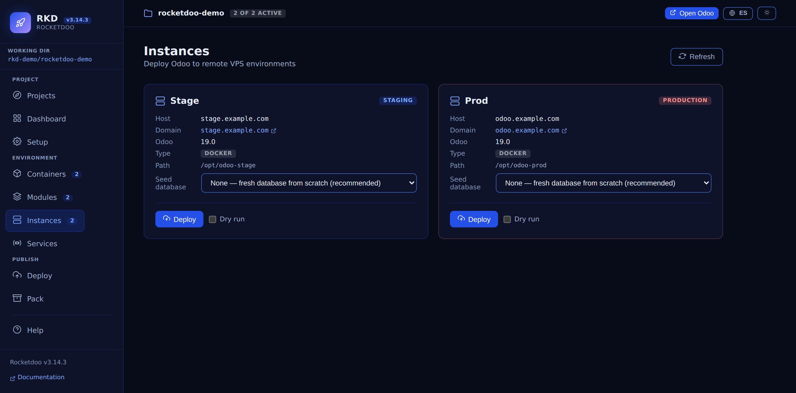
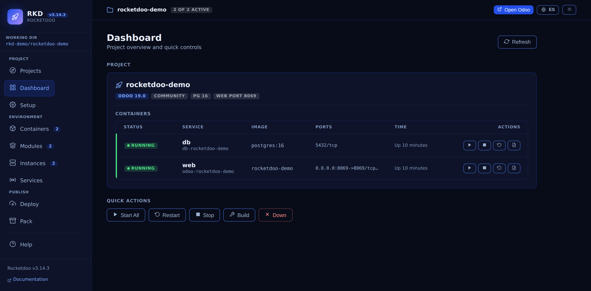

# Welcome to RKD as ROCKETDOO!

> **Version 3.14** of ROCKETDOO — seed a VPS instance with your development database, a pre-flight that stops a deploy before it breaks, Enterprise and third-party repos that finally reach the server, HTTPS on the VPS, and Odoo 20 — on top of the GUI, the golden paths, Mailpit, Traefik and CI you can generate for your own project.

**Rocketdoo is a development and delivery platform for Odoo teams that standardizes, automates, and abstracts the lifecycle of Odoo environments, from local development all the way to deployment.**

Rocketdoo is a Python-based framework designed to provide a fast and efficient development environment.

With Rocketdoo, you can deploy one or several environments for Odoo development in just a few simple steps.
It allows you to create new modules or features for both the Enterprise and Community editions.

## What's New in 3.14

Nine releases separate 3.5 from 3.14.3, and almost none of them added a command. What they did was
turn `rkd instance` from a deploy you had to supervise into one that checks the server before it
touches it — plus Odoo 20, a `pack` that leaves your secrets at home, and a GUI that stops freezing.

### 🌱 Seed a VPS instance with your development database

> **New in 3.14.** A deployed environment no longer has to start from an empty database. Pick a local
> database when you configure the environment and the deploy dumps it, transfers it, restores it on
> the server — filestore included — and neutralizes what must not run there.

~~~
rkd instance init             # "Database for stage:" → pick a local database, or none
rkd instance deploy -e stage
~~~

Three rules are worth knowing before you use it:

- **It happens once per environment.** The deploy writes a mark inside the restored database, so a
  redeploy never restores again. Seeding a second time means dropping the database on the VPS by
  hand — deliberately, because the alternative is a flag that overwrites a client's production with a
  development dump.
- **An existing database is never overwritten.** If the target already serves an Odoo that Rocketdoo
  did not seed, the deploy refuses and says so.
- **Neutralization depends on the target.** Both regenerate the database UUID and disable the Mailpit
  mail server, which points at a host that does not exist on the VPS. **Only staging** also disables
  scheduled actions, mail servers and payment providers — doing that to production would stop the
  crons of the very instance you are launching.

The admin password of a seeded database is not replaced: its users keep theirs.

>>> [How to configure it, and what the pre-flight checks](command.md#vps-instance-deployment-rkd-instance)

### 🛡️ A pre-flight that stops before it breaks, and a dry run that writes nothing

> **Since 3.11.** Both deployers now open with a pre-flight: a single read-only SSH session that
> collects facts about the server and sorts them into **blockers** and **warnings**. A blocker stops
> the deploy before anything is written.

`--dry-run` used to print "Deployment successful" without touching the VPS — and still wrote a
secrets file locally. Now it runs that same pre-flight, connects only to read, writes nothing, and
exits non-zero when something blocks. So this finally means what it looks like:

~~~
rkd instance deploy -e prod --dry-run && rkd instance deploy -e prod
~~~

It checks the connection, Docker, `sudo`, the remote path, disk space, memory, your SSH key and
agent, the Gitman file and its repositories, the Enterprise directory, the PostgreSQL version, the
database identifiers, Traefik and the public URL.

### 🏢 Enterprise and third-party repos finally reach the server

> **Since 3.11, completed in 3.13.** Choosing Enterprise in the wizard used to declare the directory
> everywhere and put it nowhere: Odoo started without the addons. Gitman repos were cloned on the VPS
> and never entered the `addons_path`.

Enterprise now travels either way — `rsync` sends your local `enterprise/`, or `clone` fetches
`odoo/enterprise` on the server through a forwarded SSH agent, leaving no credentials behind. Since
3.13 the native path installs Gitman repos exactly where the Docker path does and builds the same
canonical order: `enterprise, extra-addons, nested dirs, gitman`.

**Docker or native is a choice about packaging, not about what you get.**

### 🌐 HTTPS on the VPS: `rkd instance traefik`

> **New in 3.12.** The Odoo container only exposes its port; something has to answer on 80/443 and
> get the certificate.

~~~
rkd instance traefik -e prod
~~~

Installs Traefik on that environment's server, once per host, with the same configuration `rkd
traefik` renders locally. It is safe to run again — files you tuned and certificates already issued
are kept — and the deploy never runs it for you, because ports 80 and 443 belong to the host and not
to one project.

### 🐘 Odoo 20

> **Since 3.7.** `odoo20-ce` and `odoo20-ee` join the golden paths, and `odoo20-ce` is built by CI on
> every release.

The image needs no Dockerfile change, but **PostgreSQL does**: Odoo 20 requires **16 or newer**,
against 13 for Odoo 19 and 12 all the way back to 15. A project on PostgreSQL 14 cannot move to Odoo
20 without migrating the database first, and the matrix now refuses that pairing instead of letting
it through.

> **Create it from the terminal.** The GUI's Setup form still stops at Odoo 19, so use
> `rkd init --profile odoo20-ce` and then manage the project from the GUI as usual.

>>> [The full compatibility matrix](command.md#golden-paths-rkd-profiles)

### 🔐 A pack that leaves your secrets at home

> **Since 3.9.2.** `rkd pack` used to put the sender's own credentials in the ZIP it handed to
> someone else.

The archive no longer carries `.ssh/`, `.rkd/secrets/`, `.rkd/instance.yaml`, `.rkd/deploy.yaml`
or any `*.env`, and **no symlink enters it** — a link pointing at a secrets file used to exfiltrate
it. The panel names everything it left out, which is exactly the list the receiver has to rewrite.
Since 3.10 the verifier also reads the first 64 KiB of each entry looking for PEM headers, rather
than trusting filenames. Two credentials still travel on purpose — `odoo_pg_pass` and
`config/odoo.conf` — because the shared environment does not start without them.

### 🪪 A restored copy gets its own Compose identity

> **Since 3.9.** Two copies sharing one Compose project name meant Compose treated the original's
> containers as its own — and the copy's restore ran `DROP DATABASE` on the original's data.

`rkd unpack` now detects the clash, through `docker compose ls` **and** volume labels (a project
brought down without `-v` is absent from the first but its volumes are still there), and rewrites the
whole identity of the copy: project name, image, every container name, volumes and `db_host`. It is
all-or-nothing, and if Docker does not answer nothing is renamed — it never guesses.

### 📧 Mailpit picks a free port

> **Since 3.9.1.** Two Rocketdoo projects with `rkd mail on` no longer collide.

`mail on` keeps the ports declared in the compose file when they are free and takes the next free one
when they are not, counting ports declared by a sibling project that is switched off. It prints which
one it took and writes it back, so a browser bookmark keeps working. **The internal `1025` never
changes**: Odoo always talks to `mailpit:1025`.

### ⚡ A GUI that stops freezing

> **Since 3.14.3.** Thirty-five GUI handlers were declared `async` without a single `await`, so
> FastAPI ran them on the event loop and any blocking work froze the whole interface — log WebSockets
> included. A Docker build could hold it for five minutes.

They now run in the thread pool. Two more things the GUI gained along the way: it no longer needs
internet to draw itself (Vue is vendored, so a blocked CDN used to leave a blank page), and the token
screen has a field to paste into, for when you reach `http://localhost:8070` without the query string.

---

## What's New in 3.5

### 🖥️ A GUI that says where you are, in your language

The interface was rebuilt around what changes while you work:

- **A permanent top bar** with the active project and a pill counting running containers, so no
  screen leaves you guessing which project you are acting on.
- **Grouped sidebar navigation** — Project, Environment, Publish — plus a new **Projects** screen
  that discovers every Rocketdoo project on the host and switches between them without restarting
  the server.
- **A light theme that meets WCAG AA contrast**, and with no saved choice the GUI follows your
  operating system instead of always starting dark.
- **Spanish and English**, switchable from the top bar. What the GUI only relays — Docker logs,
  addon names, container names, raw `docker compose ps` status — is left untouched in both.

>>> [The ten screens, with screenshots](gui.md)

### ⚙️ CI for your project (`rkd ci`)

`rkd ci init` writes a GitHub Actions workflow **into your project** that lints your addons and
installs them against a real Odoo:

~~~
rkd ci init        # writes .github/workflows/rkd-ci.yml
rkd ci prepare     # regenerates what a clean clone does not carry
rkd ci modules     # the installable modules Odoo can reach
~~~

It never overwrites a workflow that differs from what it would write, and the expensive install job
is limited to pull requests by default, because Actions minutes are a shared quota on private repos.

>>> [What the generated workflow does, and what is outside it](command.md#continuous-integration-rkd-ci)

### 📁 Nested addons Odoo can actually reach

Odoo reads a static `addons_path`, so a module at `addons/oca/web_responsive` was invisible unless
that subdirectory was listed. `rkd up`, `rkd restart`, `rkd build --rebuild`, `rkd ci prepare`, the GUI's Up and the per-module
update now keep the path in sync with what is actually under `addons/`; `rkd info` warns without
writing. Entries that are not
Rocketdoo's own — Odoo's default, `enterprise`, Gitman's `external_addons`, your own paths — are
kept exactly as they are, in order.

### 📧 `rkd mail` configures the mail server, not just the transport

**Since 3.3.** `rkd mail on` now also creates the `ir.mail_server` record **`Mailpit (rkd)`** in your database, so
Odoo actually routes through Mailpit. `off` only archives it — it never deletes, so a mail server of
your own is never at risk. Projects with more than one database need `--db NAME`.

>>> [The record, the `--db` flag and a known limit](command.md#the-mail-server-record-in-odoo)

### 🔑 The GUI asks for a session token

Since 3.4, every `rkd gui` prints a URL carrying a session token, and the API rejects anything
without it. The token is good for as long as that server runs, and restarting it issues a new one. **Browsing to `http://localhost:8070` on its own no longer works** — use the URL it
prints, or `--open`.

>>> [Why, and what it does not protect against](gui.md#the-session-token)

---

## What's New in 3.2

Version 3.2 does not add a new subsystem: it makes the existing ones predictable.

### 🧭 Golden Paths (`rkd profiles`)

A *golden path* is a named, supported combination of Odoo version, edition and PostgreSQL version.
Rocketdoo shipped ten of them at the time — Odoo 15 to 19, Community and Enterprise; today there are
twelve — and they became the source of truth for both the wizard and non-interactive setup:

~~~~
rkd profiles list              # the whole matrix
rkd profiles show odoo18-ce    # detail of one profile
rkd init --profile odoo18-ce   # create the environment without any prompts
~~~~

Three of them (`odoo15-ce`, `odoo18-ce`, `odoo19-ee`) were built by CI on every release PR; the rest
are best effort. Odoo↔PostgreSQL compatibility is validated now, so the wizard can no longer produce
an unsupported pairing — Odoo 19, for instance, requires PostgreSQL 13 or above.

>>> [The full matrix and support levels](command.md#golden-paths-rkd-profiles)

### ✅ Test suite and a real CI gate

Rocketdoo now has a `pytest` suite of over 900 tests, plus `ruff` for linting, running on every pull
request across Python 3.10 to 3.13, with Docker end-to-end tests, a package build check and a
render-and-build pass over the golden paths. Nothing is `continue-on-error` any more: a red job means
the change does not merge.

>>> [How to run it before opening a PR](collaborate.md)

### 🔧 Fixes worth upgrading for

- **Docker build failed on Odoo 18 and 19.** The generated `Dockerfile` removed the PEP 668 marker in
  its own layer, but `apt install python3-dev` pulls in the `python3.N` package, which puts the file
  back — so the later `pip install` died with `externally-managed-environment`. Only Ubuntu noble
  images (`odoo:18.0`, `odoo:19.0`) ship that marker, which is why the older versions were unaffected.
  All five images are now built in CI.
- **`rkd pack` always failed with `UnboundLocalError`** when run with `--no-db`, or before any
  database existed — the two normal ways to use it. Present in 3.1.8 and earlier.
- **The GUI API accepted requests from any origin.** `rkd gui` now only accepts calls from its own
  origin. Binding to `127.0.0.1` was never protection here: the request comes from the user's own
  browser, so any page visited while the GUI was running could list the filesystem and stop containers.

---

## What's New in ROCKETDOO Version 3

Version 3 is the most complete release of **ROCKETDOO** to date. It keeps everything from version 2 and adds four major new capabilities:

### 🖥️ Graphical User Interface (GUI)

**Rocketdoo v3** ships with its own web-based GUI, launched directly from the terminal with a single command:

~~~~
rkd gui
~~~~

The GUI opens in your browser at the URL `rkd gui` prints — since 3.4 that URL carries a session
token — and provides:

- **Dashboard** — project overview with container status, Odoo version, PostgreSQL version, and quick access links.
- **Container controls** — start, stop, restart, build, pull, and remove containers without typing Docker commands.
- **Live log viewer** — real-time streaming logs from any container.
- **Mail (Mailpit)** — enable/disable the email testing service directly from the interface.
- **Modules** — list and manage Odoo add-on modules.
- **Deploy** — run deployment operations from the GUI.
- **Instance** — manage VPS deployment targets.
- **Pack / Unpack** — share or restore full development environments.
- **Gitman** — manage third-party repository dependencies.
- **Traefik** — configure the reverse proxy integration.
- **Dark and light mode** — toggle the theme to match your preference.

>>> [Learn more about the GUI](gui.md)

### 📧 Mailpit Email Testing (`rkd mail`)

The new `mail` command integrates [Mailpit](https://github.com/axllent/mailpit) — a local SMTP server and web UI that captures all outgoing emails from Odoo instead of sending them.

~~~~
rkd mail on       # Enable Mailpit and configure Odoo SMTP
rkd mail off      # Disable Mailpit and restore defaults
rkd mail status   # Show current status
rkd mail open     # Open the Mailpit web UI in the browser
~~~~

### 🌐 Traefik Reverse Proxy (`rkd traefik`)

The `traefik` command makes it easy to expose your local Odoo instance using a custom domain, either for local development or full production with HTTPS and Let's Encrypt.

~~~~
rkd traefik on      # Interactive setup: domain, mode (local/production)
rkd traefik off     # Remove Traefik integration from the project
rkd traefik status  # Show current Traefik configuration
rkd traefik guide   # Step-by-step guide for local domain setup
~~~~

### 🚀 Full VPS Instance Deployment (`rkd instance`)

The `instance` command allows you to deploy a complete Odoo instance to a VPS — either as a Dockerized build or as a native installation — using a simple interactive wizard.

~~~~
rkd instance init                # Configure stage/prod environments interactively
rkd instance deploy --env stage  # Deploy to staging
rkd instance deploy --env prod   # Deploy to production
rkd instance status              # Show configured deployment targets
~~~~

---

## From Version 2 — Still Available

All features from **ROCKETDOO v2** are fully preserved:

- `rkd scaffold` / `rkd init` — project scaffolding and configuration wizard.
- `rkd up`, `rkd down`, `rkd restart`, `rkd stop`, `rkd build`, `rkd status`, `rkd logs` — Docker container management.
- `rkd pack` / `rkd unpack` — share and restore full environments.
- `rkd del -i` — clean up `.Identifier` files created by WSL2.
- `rkd deploy` — module deployment to Odoo SH, VPS, or Dockerized instances.

On the following page, you can find detailed information about deployments using **rkd**. >>> [Deployment](deployment.md)

> Rocketdoo v3 is more powerful and easier to use than ever before...

## Overview

This tool was designed for developers who are just getting started with Odoo, as well as for experienced developers
who want to quickly deploy environments and focus solely on building new modules and features.

It’s important to note that Rocketdoo is just one of many tools available in the Odoo development ecosystem.
It does not aim to be the only or the best option — rather, it’s a practical solution that adds value, covers common development needs,
and optimizes and automates the developer’s workflow.

We know that the Odoo ERP system is broad, powerful, and complex. Depending on the client, the business requirements,
or the localization being implemented, it’s necessary to consider a series of dependencies that go beyond pure development.
These may include required Python libraries, specific dependencies for certain features, third-party modules,
or external repositories needed to ensure a successful implementation.

All these requirements and configurations often become a real burden for developers.

That’s why Rocketdoo was created — to provide an automated and intuitive environment that serves both individual developers
and development teams. Rocketdoo simplifies the process of setting up a development environment
and lets you focus on what really matters: building new modules and features.

## Description

To better understand what Rocketdoo is and how to use it properly, let’s go through a brief description
of the required tools and their purpose.

First, it’s important to mention that Rocketdoo was designed and developed to create development environments
on Linux-based operating systems, such as Ubuntu or Debian. We consider Linux to be the most suitable system
for working with this framework for the following reasons.

Rocketdoo relies on the following tools to perform its functions:

* Docker y Docker Compose.
* Git y GitHub (or any version control manager).
* Llave SSH for managing private repositories.
* Gitman.
* Python and its packages manager `pip` or `pipx`.
* Command Line Interface (CLI) usage.
* Visual Studio Code.
* Required Visual Studio Code extensions (listed later)

This list of required tools — especially Docker and Docker Compose — is one of the main reasons
why we recommend using Rocketdoo on a Linux operating system.

However, we understand that many developers prefer using Windows. In that case,
we strongly recommend using the Windows Subsystem for Linux version 2: **WSL2**.
