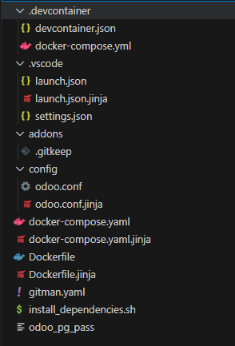
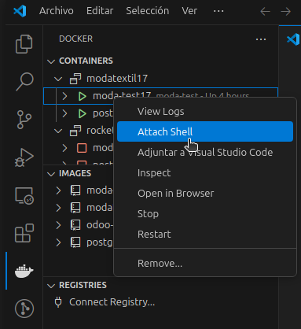
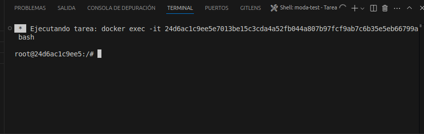
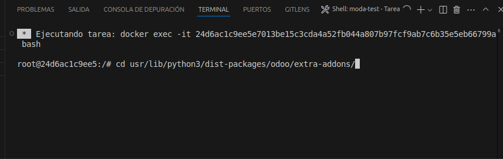
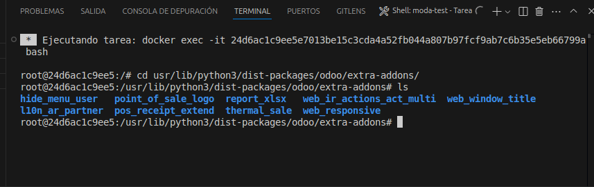
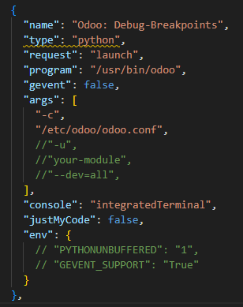
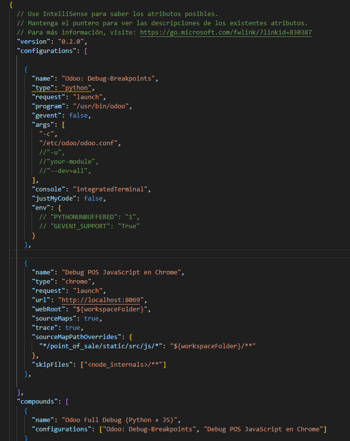

# Rocketdoo Structure

This section provides a detailed overview of how Rocketdoo is organized, enabling you to better understand its internal workings and grasp the significance and usage of key folders and files.

As shown in the image, there is an extensive list of folders and files that comprise the complete Rocketdoo structure.  
However, we will focus on the folders and files most relevant to developers.

These folders and files should be familiar to any Odoo developer.

---

## /Addons

First, let's discuss the **addons** folder.

Once your development environment is set up, whether working in Visual Studio Code or directly from the terminal, this folder will be used to host the developments you create, as well as some individually required modules.

You can create a folder with your module name and add its contents, or use the **Docker** extension for VSCode. With the *Attach Shell* option, you can open a terminal and navigate to the directory containing the modules:  
`/usr/lib/python/dist-packages/odoo/extra-addons`.

From there, you can use Odoo's **scaffold** command to generate a new module.

> **Important:** The "addons" folder within the development container is mapped as a volume to the "extra-addons" folder.  
> This is why we must navigate to that folder within the container.  
> Remember that the original `addons` folder belongs to the Odoo core, which becomes more evident when debugging code from within the container.

To create a new module using the `scaffold` command, execute it as follows:

~~~
odoo scaffold <my_module> .

~~~

This will generate a module with the necessary files and structure to start developing in the current directory.

Once created, the new module will also appear in your working environment within the **addons** folder in VSCode.

> **Remember:** The `addons` folder in your working directory is called `extra-addons` inside the Odoo container.

---

## /Config/odoo.conf

The **odoo.conf** file, located in the **/config/** directory, is particularly important for experienced Odoo developers.

This file contains all system configuration at the server level.  
It manages the mapping of third-party and custom modules, master password configuration, log file paths, and more.

However, do not worry, as you typically will not need to modify this file manually, since it is automatically configured during framework startup.

---

## /.rkd

> **Since version 3.** Everything Rocketdoo needs to remember about *this* project, beyond the files
> Odoo and Docker read, lives in the hidden `.rkd/` directory.

| File | What it holds |
|---|---|
| `.rkd/instance.yaml` | The stage and prod environments `rkd instance` deploys to: host, user, domain, Odoo and PostgreSQL versions, Enterprise and Gitman settings, the PostgreSQL resource profile, Odoo's own [performance settings](command.md#tuning-odoo-per-environment) under `resources` (3.15), the remote path, and the source database when the environment is seeded. |
| `.rkd/deploy.yaml` | The targets `rkd deploy` pushes modules to (`vps` or `odoo-sh`). |
| `.rkd/traefik.yaml` | The local reverse proxy configuration written by `rkd traefik on`. |
| `.rkd/secrets/` | Generated credentials — **never share this directory.** |

`rkd scaffold` adds five of those paths to `.gitignore` — `.rkd/secrets/`, `.rkd/instance.yaml`,
`.rkd/deploy.yaml`, `.rkd/deploy_backups/` and `.rkd/deploy.log` — and `rkd info` prints a **Secrets
at risk** panel when that coverage is missing. Note that `.rkd/traefik.yaml` is *not* among them: it
holds no credential, only the local proxy settings.

> **A pack is not sanitized to the point of being publishable.** `rkd pack` keeps the four ignored
> paths above out of the ZIP, but `odoo_pg_pass` and `config/odoo.conf` travel on purpose — the
> shared environment does not start without them — and so does anything else under `.rkd/` that is
> not on that list, such as `.rkd/traefik.yaml`. Send the archive to a teammate; do not publish it.
> [What never enters the ZIP](command.md#what-never-enters-the-zip) has the exact list.

Two more directories belong to the same generated layout: `instance/` holds the Jinja templates the
VPS deploy renders, and `deploy/` the ones the module deploy uses. You do not normally edit either.

---

## Nested addons

> **Since 3.5.** Odoo reads a static `addons_path`, so a module sitting at
> `addons/oca/web_responsive` was invisible unless that subdirectory was listed explicitly.

`rkd up`, `rkd restart`, `rkd build --rebuild` and `rkd ci prepare` now keep the path in step with
what is actually under `addons/`, and `rkd info` warns about a stale path without writing to it.
Entries that are not Rocketdoo's own — Odoo's default, `enterprise`, Gitman's `external_addons`, any
path you added — are kept exactly as they are, in order.

> **If an earlier version broke your `addons_path`, 3.10.1 repairs it.** `config/odoo.conf` is an INI
> file, where a value may continue on indented lines. Before 3.10.1 Rocketdoo rewrote only the first
> line and left the continuations orphaned, and Odoo silently dropped the whole entry — on one real
> instance a single `rkd up` took `extra-addons` out of the path and with it five of the project's
> own addons. Reading and writing now go through a parser that understands the full option, so
> rewriting the file repairs what an older version mangled.

---

## Launch.json

Within the hidden *.vscode/* directory, you will find the ***launch.json*** file, which allows you to configure code debugging options within the development container.
This file provides two primary debugging types plus an additional configuration that combines both. These two main configurations allow you to choose between debugging Python backend code or the second option for debugging the POS (Point of Sale) for JavaScript developments.
The third option is a hybrid of both configurations simultaneously.
Additionally, we have some parameters that allow you to define what and how to restart your containers to quickly reflect the changes you are making. In these parameters, you can uncomment the lines:

//"-u",
//"your-module",
//"--dev=all",

and define the name of your module under development to update changes instantly.

---

## Enterprise

As you may have noticed, when launching **ROCKETDOO**, you are asked whether you wish to work with the Community or Enterprise version of Odoo.

Great! If your answer is `"ce"` (Community Edition), no additional steps are needed.

However, if your answer is `"ee"` (Enterprise Edition), it is very important that **before** launching Rocketdoo with the command ***rocketdoo up -d*** or ***rkd up -d***, you have the **Enterprise** folder in your working directory, at the same level as the **addons** folder.

This way, the system will be able to correctly map the Enterprise modules and perform the necessary configuration in the environment to run this Odoo edition.