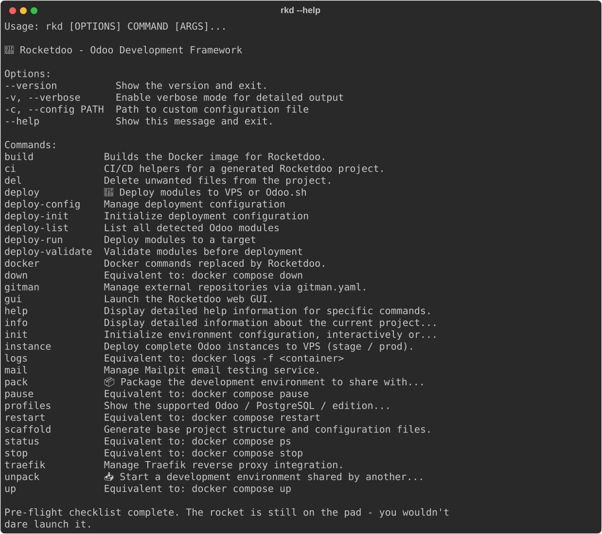
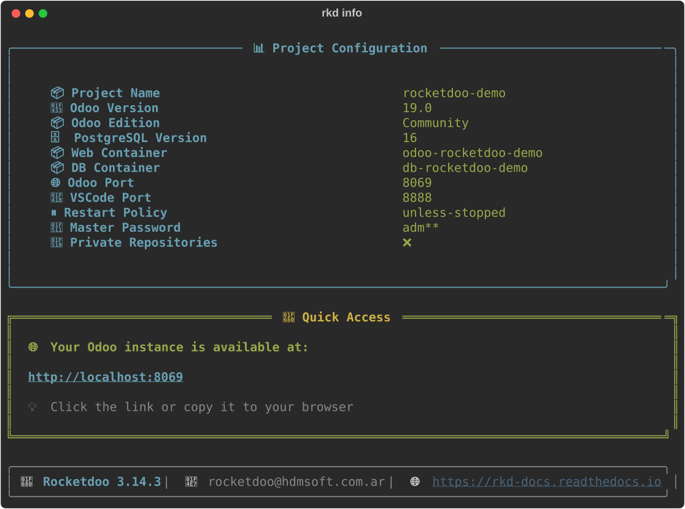
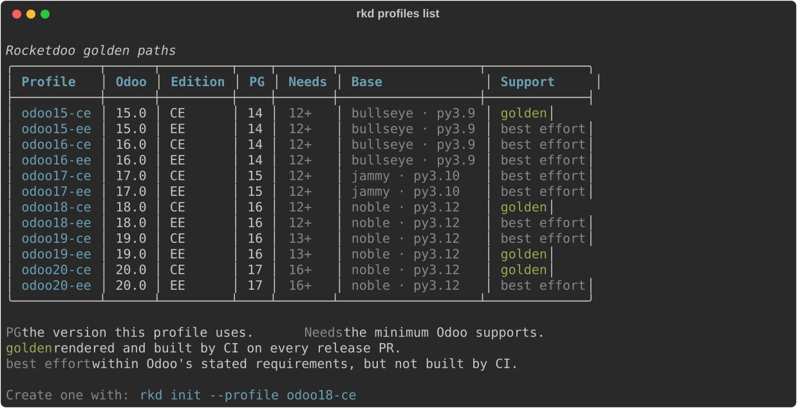
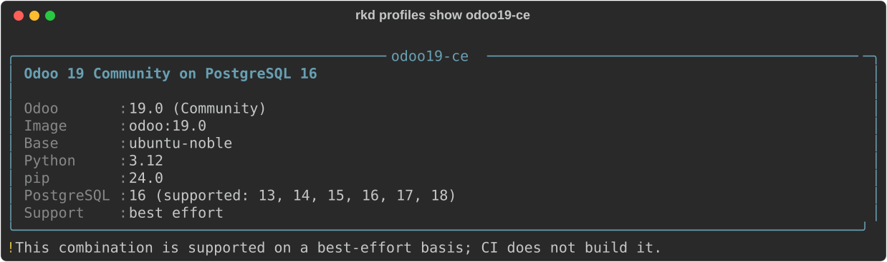
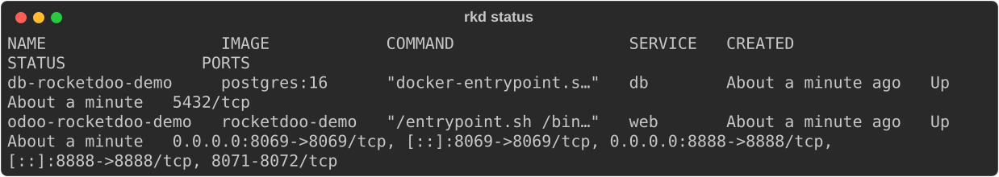
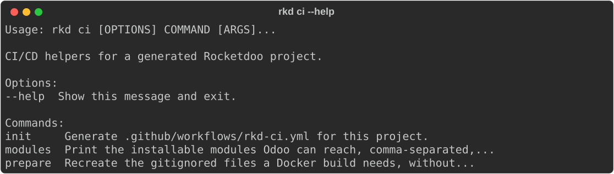
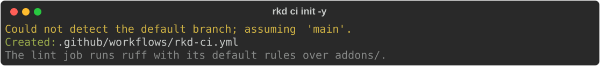
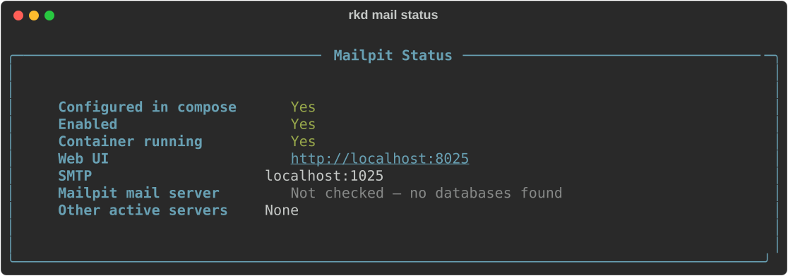
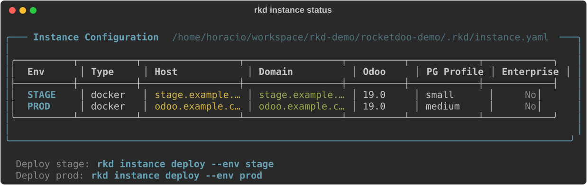

# Línea de Comandos

Aquí tienes los comandos más comunes que puedes usar en **RKD** **ROCKETDOO**.

> Podés usar tanto `rocketdoo` como el alias corto `rkd` — ambos son equivalentes.

> **TIP:** Combiná cualquier comando con `--help` para ver sus flags y opciones.  
> Ejemplo: `rkd build --help`

---

## General

* Versión de Rocketdoo:

~~~
rkd --version
~~~

* Ayuda y comandos disponibles:

~~~
rkd --help
~~~

---

## Configuración del Proyecto

* Crear el árbol de directorios y archivos:

~~~
rkd scaffold
~~~

* Iniciar el asistente de configuración:

~~~
rkd init
~~~

* O crear el entorno directamente desde un perfil soportado, sin responder preguntas:

~~~
rkd init --profile odoo18-ce
~~~

* Ver información detallada del proyecto actual:

~~~
rkd info
~~~

> Desde la 3.5, `rkd info` también avisa cuando un módulo bajo `addons/` está en un subdirectorio
> que el `addons_path` de Odoo no cubre. Sólo avisa, nunca escribe. Los que escriben la ruta son:
> `rkd up`, `rkd restart`, `rkd build --rebuild`, `rkd ci prepare`, el Up de la GUI y el update por
> módulo.

---

## Golden Paths (`rkd profiles`)

> **Nuevo en 3.2, ampliado en 3.7.** Un *golden path* es una combinación soportada, con nombre
> propio, de versión de Odoo, edición y versión de PostgreSQL. Rocketdoo trae doce —Odoo 15 a **20**,
> Community y Enterprise— y son la fuente de verdad tanto para el asistente de `rkd init` como para
> `rkd init --profile`.

* Ver la matriz completa:

~~~
rkd profiles list
~~~

* Ver el detalle de un perfil:

~~~
rkd profiles show odoo19-ce
~~~

* Crear ese entorno de punta a punta, sin pasar por el asistente:

~~~
mkdir mi-proyecto && cd mi-proyecto
rkd scaffold
rkd init --profile odoo18-ce
rkd up -d
~~~

### Niveles de soporte

| Nivel | Qué significa |
|---|---|
| **golden** | El CI renderiza **y construye** esta combinación en cada PR de release. Son las que conviene elegir. |
| **best effort** | Está dentro de los requisitos que Odoo declara y el asistente la ofrece, pero el CI no la construye. Se aceptan reportes, sin garantía. |

Hoy las combinaciones golden son `odoo15-ce`, `odoo18-ce`, `odoo19-ee` y `odoo20-ce`: entre las
cuatro cubren los tres sistemas base distintos que usan las imágenes `odoo:`, las dos ediciones y la
versión actual.

### Matriz de compatibilidad

Los datos por imagen se leyeron de las imágenes `odoo:` publicadas; los mínimos de PostgreSQL salen
de la documentación de instalación de Odoo.

| Odoo | Base | Python | pip | PostgreSQL mínimo | Recomendado |
|---|---|---|---|---|---|
| 15.0 | debian-bullseye | 3.9 | 20.3.4 | 12 | 14 |
| 16.0 | debian-bullseye | 3.9 | 20.3.4 | 12 | 14 |
| 17.0 | ubuntu-jammy | 3.10 | 22.0.2 | 12 | 15 |
| 18.0 | ubuntu-noble | 3.12 | 24.0 | 12 | 16 |
| 19.0 | ubuntu-noble | 3.12 | 24.0 | **13** | 16 |
| 20.0 | ubuntu-noble | 3.12 | 24.0 | **16** | 17 |

Odoo 19 subió el mínimo de PostgreSQL de 12 a 13, y **Odoo 20 lo volvió a subir a 16**: el salto más
grande de la serie. Rocketdoo valida la combinación al cargar el perfil: un `db_version` por debajo
del mínimo de esa versión de Odoo es un error, no una advertencia, así que el asistente ya no puede
generar un entorno que no arranque.

> **Pasar un proyecto existente a Odoo 20.** Como la imagen comparte base con la 18 y la 19, el
> `Dockerfile` generado no necesita ningún cambio — pero un proyecto parado en PostgreSQL 14 o 15 no
> puede cambiar de versión sin más. Primero hay que migrar la base a 16 o superior; la matriz ahora
> rechaza la combinación en vez de dejarla pasar y fallar al arrancar.

> **Odoo 19 y AI:** las funciones de AI de Odoo 19 necesitan la extensión `pgvector`, que se
> distribuye para PostgreSQL 15 en adelante. `rkd profiles show odoo19-*` avisa cuando el perfil usa
> una versión menor.

> **Enterprise:** cualquier perfil `*-ee` espera un directorio `./enterprise` con los add-ons de Odoo
> Enterprise (requiere suscripción), al mismo nivel que `addons/`, antes de correr `rkd up -d`.

---

## Gestión de Contenedores

* Lanzar el despliegue de Odoo (iniciar contenedores en modo detached):

~~~
rkd up -d
~~~

* Conocer el estado de tus contenedores:

~~~
rkd status
~~~

* Detener todos los contenedores:

~~~
rkd stop
~~~

* Reiniciar los contenedores:

~~~
rkd restart
~~~

* Eliminar los contenedores:

~~~
rkd down
~~~

* Eliminar contenedores y sus volúmenes asociados:

~~~
rkd down -v
~~~

* Forzar la reconstrucción del entorno:

~~~
rkd build
~~~

* Reconstruir y reiniciar contenedores en un solo paso:

~~~
rkd build --rebuild
~~~

* Ver los logs de los contenedores:

~~~
rkd logs
~~~

* Seguir los logs en tiempo real de un contenedor específico:

~~~
rkd logs <nombre_contenedor> -f
~~~

---

## Compartir Entornos

* Empaquetar todo tu proyecto Odoo completo para compartir con otros desarrolladores:

~~~
rkd pack                   # entorno completo + backup de la base + filestore
rkd pack --no-db           # sólo los archivos del entorno
rkd pack -o /tmp/mi.zip    # elegir la ruta de salida
rkd pack --db-name demo    # elegir la base, cuando el proyecto tiene varias
rkd pack --yes             # sin preguntar: sigue sin backup si el contenedor de base está caído
~~~

* Desempaquetar el proyecto compartido en un directorio previamente creado:

~~~
rkd unpack                 # configuración completa: puertos, SSH, restore de la base
rkd unpack --build         # reconstruir la imagen Docker primero (recomendado la primera vez)
rkd unpack --no-restore    # saltear el restore de la base
rkd unpack --ssh-key NOMBRE  # usar esta clave de ~/.ssh/ en vez de preguntar
rkd unpack --no-ssh        # el proyecto no tiene repositorios privados
rkd unpack --yes           # aceptar las sugerencias ante conflictos de puertos
~~~

### Qué nunca entra al ZIP

> **Desde la 3.9.2.** `rkd pack` le entregaba las credenciales del emisor a quien recibiera el
> archivo.

El archivo deja afuera `.ssh/`, `.rkd/secrets/`, `.rkd/instance.yaml`, `.rkd/deploy.yaml`,
`traefik/certs/acme.json` y todo `*.env` (salvo `*.env.example`), y **ningún enlace simbólico entra**
— un enlace apuntando a un archivo de secretos sacaba ese archivo del proyecto. Los hard links se
detectan por inodo. También descarta `.rkd/deploy_backups`, que guarda el historial de backups del
emisor y a nadie más le sirve. El panel final nombra todo lo que dejó afuera, que es justamente la
lista que el receptor tiene que reescribir de su lado.

> **Dos credenciales sí viajan, a propósito.** `odoo_pg_pass` y `config/odoo.conf` se empaquetan,
> porque sin ellos el entorno compartido no arranca: Compose monta el primero como secreto de Docker y
> el Dockerfile copia el segundo al construir. Son las credenciales locales del entorno que se está
> entregando, que es el sentido del ZIP — así que tratá un archivo de Rocketdoo como algo que le
> mandás a un compañero, no como algo que publicás.

Desde la 3.10 el verificador lee los primeros 64 KiB de cada entrada buscando cabeceras PEM en vez de
confiar en los nombres de archivo, y separa los dos casos: un aviso **rojo** cuando se coló un archivo
que Rocketdoo declara secreto, y uno **amarillo**, más tranquilo, cuando algo simplemente se lee como
una clave privada — un proyecto Enterprise suele llevar unos cinco, de las localizaciones de Odoo.

El ZIP tampoco se empaqueta a sí mismo, ni arrastra los backups que dejaron packs anteriores (3.8.1).

### La copia restaurada recibe su propia identidad Compose

> **Desde la 3.9.** Cuando el nombre de proyecto Compose que viene en el archivo ya lo usa otro
> directorio de tu host, `rkd unpack` renombra la copia en vez de chocar con el original.

Dos copias compartiendo un nombre de proyecto hacían que Compose tratara los contenedores del
original como propios de la copia —recreándolos y destruyéndolos— y que el restore corriera
`DROP DATABASE` sobre los datos del original. El renombre es todo o nada y cubre `name:`, `image:`,
cada `container_name` (incluido el de Mailpit comentado), definiciones y referencias de volúmenes, y
`db_host` en `config/odoo.conf`.

La detección consulta `docker compose ls` **y** mira las etiquetas de los volúmenes, porque un
proyecto bajado con `rkd down` (sin `-v`) no figura en el primero y sus volúmenes siguen en disco. Si
Docker no responde, no se renombra nada: Rocketdoo nunca adivina. La CLI pregunta —`Rename this copy
to <sugerido>?`—, `--yes` acepta, y la GUI acepta sola.

La copia también se lleva sus propios puertos cuando el original los tiene tomados, y el mensaje
distingue "este puerto está en uso" de "este puerto es de la otra copia, que está apagada".

---

## Utilidades

* Eliminar archivos `.Identifier` generados por WSL2 al copiar archivos desde Windows:

~~~
rkd del -i
~~~

* Previsualizar qué archivos se eliminarían (simulación, sin borrar nada):

~~~
rkd del -i --dry-run
~~~

* Actualizar masivamente los paquetes de módulos cargados como repositorios públicos con Gitman:  
(Este comando debe ejecutarse dentro del contenedor.)

~~~
gitman update
~~~

### Un comando que no está en `--help`

> **Nuevo en la 3.10.** El epílogo de `rkd --help` termina con una línea sobre un cohete que sigue en
> la plataforma. Es una pista.

~~~
rkd launch
~~~

Un cohete sube por un campo de estrellas en la pantalla alternativa de la terminal —como `vim` o
`less`, así que tu scrollback queda intacto— y el vuelo termina en una de seis frases del "Zen de
Odoo" sobre customizar con Studio. La animación se saltea sin TTY, con `TERM` en `dumb` o `unknown`, o
en una terminal menor a 25×13, pero **el mensaje se imprime igual**, así que `rkd launch | cat` se
lee. Respeta `NO_COLOR`.

---

## ⚙️ Integración Continua (`rkd ci`)

> **Nuevo en la 3.5.** `rkd ci` escribe un workflow de GitHub Actions **para tu proyecto** — no para
> Rocketdoo. Lintea tus addons y, opcionalmente, los instala contra un Odoo real.

* Generar `.github/workflows/rkd-ci.yml`:

~~~
rkd ci init
~~~

En una terminal esto **te pregunta cuándo debe correr el job de instalación**, con `pull_request`
como valor por defecto. Respondé de entrada, o saltate la pregunta:

~~~
rkd ci init -y                              # toma el default, sin preguntar
rkd ci init --install-trigger never         # sólo lint
~~~

| Opción | Descripción |
|--------|-------------|
| `--install-trigger` | Cuándo corre el job de instalación: `pull_request`, `push`, `manual`, `never`. Se pregunta si lo omitís; `pull_request` sin terminal |
| `--force` | Sobreescribir un workflow que difiera del render actual |
| `-y, --yes` | Saltear la pregunta del install-trigger y tomar el default |

Nunca pisa un archivo que difiera de lo que escribiría, sin `--force`, venga la diferencia de una
edición a mano o de un cambio de configuración. Lo que te informa: `Created:` si el archivo es
nuevo, *already up to date* si coincide, una advertencia que nombra `--force` si difiere, y
`Overwritten:` cuando se lo pasás.

* Regenerar los archivos que un clon limpio no trae:

~~~
rkd ci prepare
~~~

`config/odoo.conf` y `odoo_pg_pass` están gitignoreados — tienen credenciales —, así que un clon
limpio no los tiene. El build copia `config/odoo.conf` dentro de la imagen
(`COPY ./config/odoo.conf`) y compose le pasa `odoo_pg_pass` como secret al levantar, así que sin
este paso un checkout limpio no llega a ningún lado. También sincroniza el `addons_path`. Nunca
sobreescribe un `odoo.conf` que ya exista, que es lo que está informando la salida de arriba.

Pasá `--admin-passwd` para fijar el master password que escribe; si no, se genera uno.

* Listar los módulos instalables que Odoo puede realmente alcanzar:

~~~
rkd ci modules
~~~

Los imprime separados por comas en stdout, para `MODULES=$(rkd ci modules)` dentro del workflow.

### Qué hace el workflow generado

| Job | Cuándo corre | Qué cuesta |
|-----|--------------|------------|
| **Lint** | En cada pull request, en los push a la rama por defecto, y a mano | Segundos |
| **Instalación** | En pull requests contra la rama por defecto, por defecto | Varios minutos |

El workflow se dispara con `pull_request`, con `push` **sólo a la rama por defecto**, y con
`workflow_dispatch`. Pushear una rama de feature sin un pull request abierto no corre nada. El job
de lint corre `ruff check` sobre `addons/` y después `rkd deploy validate -p addons`.

El job de instalación es el caro, y por eso viene limitado por defecto. En repos **privados** el
plan Free da 2.000 minutos de Actions por mes compartidos entre toda tu cuenta; los repos
**públicos** no consumen esa cuota. Cambiá el disparador con `--install-trigger` si ese reparto no
te sirve.

> Esos números son de GitHub, no de Rocketdoo, y GitHub los cambia:
> [mirá la facturación de Actions vigente](https://docs.github.com/en/billing/managing-billing-for-github-actions/about-billing-for-github-actions).

**Lint de los manifests.** Las reglas por defecto de ruff marcan `B018` en todo `__manifest__.py` —
por definición de Odoo es un dict literal suelto —, así que el workflow generado pasa
`--extend-per-file-ignores "**/__manifest__.py:B018"`. Sin eso el lint sale rojo en todo proyecto
Odoo.

> `rkd ci init` se despide diciendo *"the lint job runs ruff with its default rules"*. El workflow
> generado sí agrega la excepción de arriba — el impreciso es el mensaje, no el workflow.

### Qué queda fuera del camino generado

- **Enterprise y repos privados por SSH.** El workflow se emite igual, sin el job de instalación y
  con el motivo como comentario: un runner no tiene acceso a tus fuentes privadas.
- **Fuentes privadas de Gitman.** `rkd ci init` avisa si `gitman.yaml` tiene fuentes `git@`/`ssh://`,
  pero no puede distinguir un HTTPS privado de uno público: ese build falla en el runner sin aviso
  previo.
- **Deploy a staging.** Diferido a propósito: `rkd deploy` no tiene forma headless de generar un
  `deploy.yaml`, así que el workflow generado sólo lintea e instala.

---

## 📧 Mail — Testing de Email con Mailpit (`rkd mail`)

Mailpit es un servidor SMTP local con interfaz web que captura todos los emails salientes de Odoo en lugar de enviarlos realmente. Ideal para probar flujos de email sin afectar a usuarios reales.

* Activar Mailpit (inicia el servicio y configura el SMTP de Odoo automáticamente):

~~~
rkd mail on
~~~

* Desactivar Mailpit y restaurar la configuración SMTP predeterminada:

~~~
rkd mail off
~~~

* Ver el estado actual de Mailpit:

~~~
rkd mail status
~~~

* Abrir la interfaz web de Mailpit en el navegador:

~~~
rkd mail open
~~~

### Mailpit elige un puerto de host libre

> **Desde la 3.9.1.** Los puertos del host ya no son fijos en 1025 y 8025, así que dos proyectos
> Rocketdoo con Mailpit activo ya no chocan.

`rkd mail on` lee los puertos declarados en el compose, los conserva cuando están libres y toma el
siguiente libre cuando no — contando también los puertos que declara un proyecto hermano que está
apagado, no sólo los que están en uso ahora mismo. Imprime cuáles tomó y **los escribe en el compose
al activar Mailpit**; `rkd mail off` sólo comenta el bloque y deja esos números donde están, así el
proyecto conserva los mismos puertos la próxima vez y un favorito del navegador sigue sirviendo.

`rkd mail open` y `rkd mail status` leen el puerto publicado real en vez de dar por sentado el 8025,
que es justamente por lo que el panel de estado es el lugar donde mirar la dirección de la interfaz
web.

**El puerto interno nunca cambia.** Dentro de la red Docker, Odoo siempre le habla a `mailpit:1025`;
lo que se mueve es sólo el lado del host.

### El servidor de correo en Odoo

> **Nuevo en la 3.3.** Además del toggle de compose y `odoo.conf`, `on`/`off`/`status` ahora leen y
> escriben un registro `ir.mail_server` en tu base, llamado **`Mailpit (rkd)`**, con
> `smtp_host = mailpit` y `sequence = 1`. Antes de esto, activar Mailpit configuraba el transporte
> pero dejaba a Odoo apuntando al servidor de correo que tuviera la base.

`off` sólo archiva el registro (`active = false`) — nunca borra, así que un servidor de correo tuyo
no corre riesgo. El registro se identifica por nombre más `smtp_host`: si lo renombrás a mano, `off`
no lo va a encontrar (y te lo dice) y `on` va a crear uno nuevo.

**Los proyectos con varias bases necesitan `--db`:**

~~~
rkd mail on --db mi_base
rkd mail status --db mi_base
rkd mail off --db mi_base
~~~

Con exactamente una base en el proyecto se elige sola. Con dos o más y sin `--db`, el comando no lee
ni escribe el registro, y te lo informa.

Para esta parte el contenedor `db` tiene que estar arriba. Si no lo está, el toggle de compose y
`odoo.conf` se hace igual y el paso del servidor de correo se informa como no realizado — corré
`rkd up -d` y repetí el mismo comando.

> **Límite conocido.** `sequence = 1` no garantiza que gane Mailpit. Odoo filtra los servidores de
> correo por `from_filter` *antes* de ordenar por `sequence`, así que otro servidor activo cuyo
> `from_filter` matchee al remitente puede ganarle igual. `rkd mail status` avisa cuando hay otros
> servidores activos, pero no lee ni escribe `from_filter`.

---

## 🌐 Reverse Proxy Traefik (`rkd traefik`)

Traefik permite exponer tu instancia local de Odoo con un dominio personalizado, tanto para desarrollo local (HTTP) como para entornos de producción (HTTPS con Let's Encrypt).

* Activar Traefik para este proyecto (asistente interactivo — solicita dominio y modo):

~~~
rkd traefik on
~~~

* Activar con opciones específicas:

~~~
rkd traefik on --domain miproyecto.local --mode local
rkd traefik on --domain miproyecto.com --mode production --email ops@example.com
~~~

> **`--email` se agregó en la 3.11.** Con `--domain`, `--mode`, `--traefik-dir` y `--email` el
> asistente corre desatendido, que es lo que necesita un script o un job de CI.

* Desactivar Traefik para este proyecto (restaura el acceso directo por puerto):

~~~
rkd traefik off
~~~

* Ver el estado de la integración con Traefik:

~~~
rkd traefik status
~~~

* Ver la guía paso a paso para configurar dominios locales (`/etc/hosts` y WSL2):

~~~
rkd traefik guide
~~~

> Modos de Traefik:
> - **local** — Solo HTTP, dominio personalizado vía `/etc/hosts`.
> - **production** — HTTPS con certificado Let's Encrypt automático.

> **`off` sólo borra el override.** Tu `docker-compose.yaml` no se toca nunca, así que reconfigurar es
> `rkd traefik off` y después `on` de nuevo. Cuando existe `.rkd/instance.yaml`, `rkd traefik status`
> además apunta a [`rkd instance traefik`](#instalar-traefik-en-el-vps), que es la contraparte remota
> de este comando.

Este comando configura el proxy **en tu máquina**. Para instalar Traefik en el servidor al que
despliega un entorno, ver [Instalar Traefik en el VPS](#instalar-traefik-en-el-vps).

---

## 🚀 Despliegue de Instancias en VPS (`rkd instance`)

El comando `instance` despliega una instancia completa de Odoo en un VPS. Soporta dos tipos de despliegue:

- **docker** — transfiere el Dockerfile + compose y construye en el VPS.
- **native** — instala Odoo mediante los paquetes apt oficiales en el servidor.

> **Desde la 3.13, la elección es sobre el empaquetado, no sobre lo que obtenés.** Los dos caminos
> instalan los repositorios de gitman en el mismo lugar y arman el mismo `addons_path` canónico:
> `enterprise, extra-addons, directorios anidados, gitman`. Hasta la 3.13 el camino nativo ponía
> Enterprise último e ignoraba los directorios anidados.

* Configurar los entornos stage/producción de forma interactiva (guarda en `.rkd/instance.yaml`):

~~~
rkd instance init
~~~

> **El asistente agrega, ya no reemplaza (3.11).** Cada entorno se ofrece por separado —
> `Reconfigure stage?`, `Configure a prod environment?`— y lo que no tocás queda exactamente como
> estaba. Reconfigurar `stage` antes borraba `prod`. El tipo de despliegue se pregunta una sola vez y
> aplica a los entornos nuevos; uno existente conserva el suyo. Al final, un resumen informa cada
> entorno como `added`, `kept`, `updated` o `removed`.

* Empezar de cero, descartando lo que no vuelvas a configurar:

~~~
rkd instance init --force
~~~

### Qué pregunta el asistente

Por entorno: tipo de despliegue, host del VPS, puerto y usuario SSH, autenticación (una clave SSH
elegida de `~/.ssh/`, o el nombre de una variable de entorno con la contraseña), versión de Odoo y —en
Docker— tag de la imagen, dominio, mail para Let's Encrypt, versión de PostgreSQL, usuario y nombre de
la base. Después la master password, la **base de origen** (ver abajo), si usa Enterprise y cómo debe
llegar al servidor, si usa gitman, el perfil de recursos de PostgreSQL (`small` para un VPS de menos
de 2 GB de RAM, `medium` para 4–8 GB, `large` para 16+), **los parámetros de rendimiento de Odoo**
(ver abajo) y la ruta remota.

> **Enterprise llega al servidor de dos formas (3.11).** `rsync` transfiere tu directorio
> `enterprise/` local; `clone` trae `odoo/enterprise` en el VPS con el **agente SSH reenviado**, así
> no queda ninguna credencial en el servidor. Antes de la 3.11, elegir Enterprise declaraba el
> directorio en el Dockerfile, en el compose y en los dos `addons_path` — y no lo ponía en ningún
> lado, así que Odoo arrancaba sin los add-ons.

> **Rocketdoo se niega a escribir acá si esto no es un proyecto Rocketdoo** (sin un `Dockerfile` y un
> `docker-compose.yaml` juntos), porque el asistente guarda credenciales bajo `.rkd/`.

### Sembrar un entorno con una base local

> **Nuevo en la 3.14.** Por defecto un entorno desplegado arranca con una base nueva. El asistente
> además ofrece `Restore local database '<nombre>' (with its filestore)` por cada base que encuentra,
> y entonces el deploy la vuelca, la transfiere, la restaura en el servidor y la neutraliza.

Pasa **una sola vez por entorno**: el deploy escribe una marca `rkd.seeded_from` dentro de la base
restaurada y un redeploy nunca vuelve a restaurar. Para sembrar una segunda vez hay que dropear la
base en el VPS a mano — deliberadamente, porque la alternativa es un flag que pisa la producción de un
cliente con un dump de desarrollo. Una base que el destino ya sirve y que Rocketdoo no sembró nunca se
pisa: el deploy se niega y lo dice.

La neutralización difiere según el destino. Los dos regeneran el UUID de la base, desactivan el
servidor de correo de Mailpit —que apunta a un host que en el VPS no existe, así que dejarlo haría
fallar todo el correo saliente en silencio— y reapuntan `web.base.url` al dominio del entorno,
borrando `web.base.url.freeze` para que el valor nuevo sea el que Odoo use. **Sólo staging** desactiva además las acciones programadas, los
servidores de correo y los proveedores de pago; hacerle eso a producción apagaría los crons de la
instancia que estás lanzando.

La contraseña del admin de una base sembrada no se reemplaza —sus usuarios conservan las suyas— y el
panel final lo dice, en vez de prometer una contraseña nueva.

### Afinar Odoo por entorno

> **Nuevo en la 3.15.** El bloque de rendimiento del `odoo.conf` que se despliega —workers, hilos de
> cron, límites de memoria y de tiempo— se configura por entorno, en vez de quedar fijado por el
> nombre del entorno.

El asistente hace una sola pregunta, que viene en no por defecto:

~~~
Performance: 2 workers, 1024 MiB soft limit, 120s request limit.
Tune Odoo's performance settings for this server? [y/n] (n)
~~~

Decir que sí recorre los siete valores con los efectivos como default, así que contestar de corrido
no cambia nada. Quedan guardados bajo `resources`, en la entrada de ese entorno en
`.rkd/instance.yaml`:

~~~
environments:
  prod:
    resources:
      workers: 4
      max_cron_threads: 2
      limit_memory_soft: 2147483648    # bytes, por worker
      limit_memory_hard: 2684354560    # bytes, por worker
      limit_time_cpu: 600              # segundos
      limit_time_real: 1200            # segundos
      limit_request: 8192
~~~

**Todos los campos son opcionales, y uno ausente conserva el default que implica el nombre del
entorno**, que es lo que Rocketdoo emitía antes de que esto existiera — así que un `instance.yaml`
sin bloque `resources` se despliega exactamente igual que siempre.

| | `stage` | `prod` |
|---|---|---|
| `workers` | 1 | 2 |
| `max_cron_threads` | 1 | 1 |
| `limit_memory_soft` | 768 MiB | 1 GiB |
| `limit_memory_hard` | 1 GiB | 1.5 GiB |
| `limit_time_cpu` | 60 s | 60 s |
| `limit_time_real` | 120 s | 120 s |
| `limit_request` | 8192 | 8192 |

El caso para el que existe: un proyecto cuyo `odoo.conf` sube `limit_time_cpu` y `limit_time_real` a
600/1200 para importaciones grandes y reportes pesados. Desplegarlo escribía 60/120 encima de esos
valores, cortando las dos operaciones a la mitad — y editar el archivo en el servidor no era
solución, porque el deploy siguiente lo reescribe, en los dos caminos y sin ninguna guarda, así que
un ajuste a mano se pierde en silencio.

Hay dos errores que se rechazan en vez de desplegarse: un número negativo, y un `limit_memory_hard`
por debajo de `limit_memory_soft` — Odoo mata el worker en lugar de reciclarlo.

> **Los límites de memoria son por worker, no por servidor.** El chequeo `memory` del pre-flight suma
> `workers + max_cron_threads + 2` procesos al límite blando, más la parte de PostgreSQL, y desde la
> 3.15 usa **los valores efectivos de ese entorno** en vez de las constantes de Rocketdoo — así que un
> `resources` que no entra en el VPS bloquea el deploy antes de escribir nada, y lo nombra con esos
> números. Su sugerencia ahora apunta a `workers` y `limit_memory_soft`, que es la perilla que existe.

> **No está en la GUI.** La pantalla Instancias no tiene campos de rendimiento: se configuran con
> `rkd instance init` o editando `.rkd/instance.yaml`. Desde la 3.15, guardar un entorno desde la GUI
> conserva el bloque `resources` existente en vez de borrarlo.

> **El dimensionamiento no se lee del servidor, a propósito.** La RAM física no es la RAM disponible
> —un VPS puede tener PostgreSQL y otra cosa al lado—, así que Rocketdoo no adivina un número por vos;
> chequea el que elegiste contra lo que midió.

> **`resources` y el perfil de recursos de PostgreSQL son perillas distintas.**
> `small`/`medium`/`large` dimensiona **PostgreSQL** (shared buffers y conexiones); `resources` afina
> **Odoo**.

> **Un cambio de comportamiento para los deploys nativos (3.15).** El template de Docker fijaba
> `limit_request = 8192` mientras que el `odoo.conf` nativo no declaraba ninguno de los tres límites
> de tiempo y caía en los defaults de Odoo. Ahora los dos caminos escriben la misma respuesta, así
> que un entorno nativo existente pasa de `limit_request` 65536 a 8192 — el worker se recicla más
> seguido, que es la más conservadora de las dos. Los otros dos límites no se mueven.

### El pre-flight, y un dry run que no escribe nada

> **Desde la 3.11.** Los dos deployers arrancan por un pre-flight: una sola sesión SSH de sólo lectura
> que junta hechos del servidor y los clasifica en **bloqueantes** y **avisos**. Un bloqueante corta el
> deploy antes de escribir nada.

Los chequeos: `vps connection`, `docker`, `sudo`, `remote path`, `disk space`, `memory`,
`ssh key file`, `ssh agent`, `ssh agent socket`, `gitman file`, `gitman repositories`,
`gitman dependency script`, `enterprise directory`, `enterprise repository`, `postgresql version`,
`database identifiers`, `native host`, `seed database`, `traefik` y `public url`. Sembrar agrega dos
bloqueantes propios —la base de origen tiene que seguir existiendo, y un dump de un PostgreSQL más
nuevo que el del servidor no restaura— y sube el piso de `disk space` en el doble de lo que se va a
sembrar.

El `--dry-run` antes imprimía "Deployment successful" sin tocar el VPS, y además escribía un archivo
de secretos en local. Ahora corre ese mismo pre-flight, conecta sólo para leer, **no escribe nada** y
sale con código distinto de cero cuando algo bloquea — así que esta cadena por fin significa lo que
parece:

~~~
rkd instance deploy --env prod --dry-run && rkd instance deploy --env prod
~~~

* Desplegar en el entorno staging:

~~~
rkd instance deploy --env stage
~~~

* Desplegar en producción (con confirmación):

~~~
rkd instance deploy --env prod
~~~

* Desplegar en producción omitiendo la confirmación:

~~~
rkd instance deploy --env prod --yes
~~~

* Correr el pre-flight sin desplegar (dry run):

~~~
rkd instance deploy --env prod --dry-run
~~~

> **Confirmaciones.** `Deploy <env> to <host>?` viene en no por defecto, `prod` agrega un aviso, y un
> entorno configurado para sembrarse pregunta otra vez — en `prod` hay que escribir `prod` literal.

* Ver el estado de todos los destinos de despliegue configurados:

~~~
rkd instance status
~~~

### Instalar Traefik en el VPS

> **Nuevo en la 3.12.** El contenedor de Odoo sólo expone su puerto. Alguien tiene que contestar en el
> 80 y el 443 y conseguir el certificado, y ese alguien es Traefik.

~~~
rkd instance traefik --env prod
rkd instance traefik --env stage --traefik-dir /opt/traefik --email ops@example.com
~~~

Instala Traefik en el servidor de ese entorno —una vez por host— con la misma configuración que `rkd
traefik` renderiza en local, leyendo `host`, `user` y la dirección de Let's Encrypt de
`.rkd/instance.yaml`. Volver a correrlo es seguro: los archivos que retocaste y los certificados ya
emitidos se conservan, y una instalación propia tuya se respeta y se reporta, no se reemplaza. Sale
con error cuando los puertos 80/443 los tiene otra cosa, o cuando al final nada termina sirviendo ese
Odoo.

Los entornos nativos se rechazan: hoy no tienen un proxy inverso adelante.

**El deploy nunca lo corre por vos.** Los puertos 80 y 443 son del host, no de un proyecto, así que
instalar un proxy ahí es una decisión que tomás una vez, explícitamente.

> **El panel final ya no afirma una URL que no probó (3.12).** Después de desplegar, Rocketdoo sondea
> el dominio desde el VPS por HTTP y por HTTPS y distingue cuatro desenlaces: Odoo responde, Traefik
> responde pero no alcanza a Odoo, el certificado no se emitió, o no responde nada. Cuando no responde
> nada, nombra `rkd instance traefik --env <env>` como el arreglo. Un deploy nativo promete
> `http://<host>:8069` y dice sin vueltas que todavía no hay proxy inverso.

---

## 🖥️ Interfaz Gráfica (`rkd gui`)

Lanza la GUI web de Rocketdoo en tu navegador. Proporciona gestión completa de contenedores, logs en vivo, mail, deploy y más — todo sin escribir comandos.

* Iniciar la GUI en el puerto predeterminado (8070):

~~~
rkd gui
~~~

> **Desde la 3.4, leé la URL que imprime.** Cada ejecución genera un token de sesión y la GUI no
> carga sin él: `http://127.0.0.1:8070/?token=<token>`. Reiniciar `rkd gui` emite uno nuevo. Ver
> [Interfaz Gráfica (GUI)](gui.md#el-token-de-sesion).

> **Desde la 3.8, llegar sin el token ya no es un callejón sin salida.** `http://localhost:8070` a
> secas —que es a donde te manda el aviso de puertos de VSCode— ahora muestra una tarjeta con un campo
> para pegar el token, y la pestaña del navegador recuerda el último que funcionó.

> **Desde la 3.8, un puerto ocupado falla con honestidad.** `rkd gui` antes imprimía el panel completo
> con un token recién emitido y el error de bind debajo; copiar esa URL más nueva daba un 401, porque
> el único que conoce su token es el servidor que está escuchando. Ahora chequea el bind antes de
> imprimir nada, explica que la URL que sirve es la que imprimió la otra sesión, ofrece un puerto
> libre y sale con error.

* Iniciar la GUI en un puerto personalizado:

~~~
rkd gui --port 9090
~~~

* Iniciar la GUI y abrir el navegador automáticamente:

~~~
rkd gui --open
~~~

* Iniciar la GUI para un proyecto en un directorio específico:

~~~
rkd gui --cwd /ruta/al/proyecto
~~~

> La GUI está disponible en `http://localhost:8070` por defecto — **en la URL con el token que
> imprime**. Presioná `Ctrl+C` para detenerla.

>>> [Más información sobre la GUI](gui.md)
