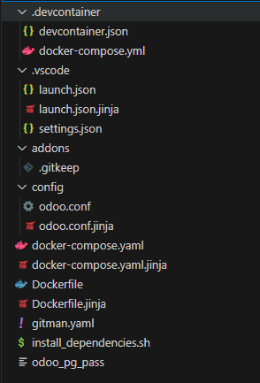
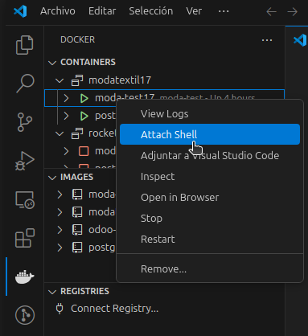
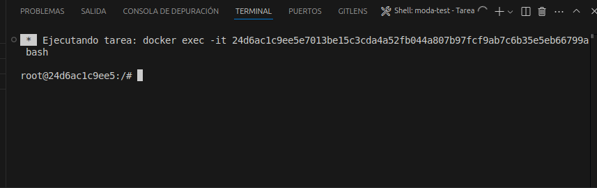
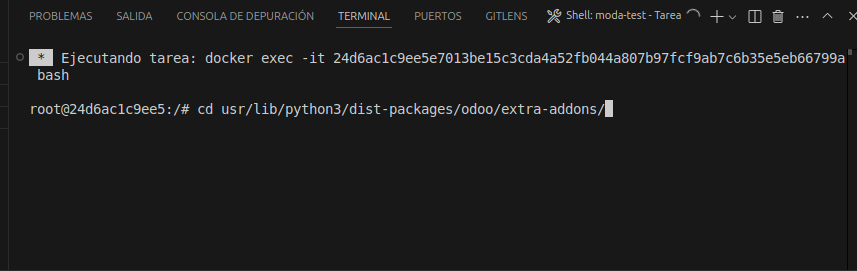
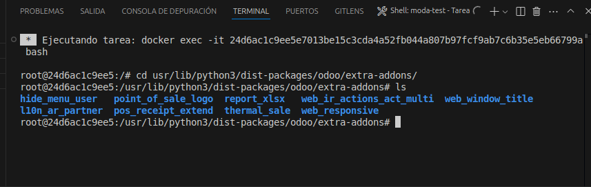
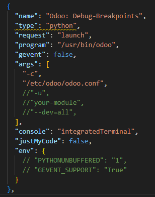
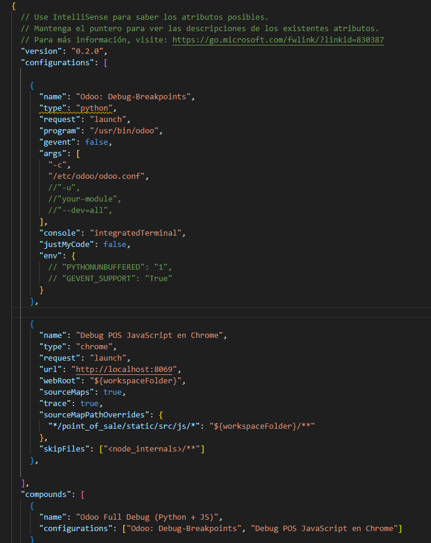

# Estructura de Rocketdoo

En esta sección veremos con mayor claridad cómo está conformada la estructura de Rocketdoo, y de esta manera podremos entender mejor cómo funciona internamente, o al menos comprender la importancia y el uso de algunas carpetas y archivos de Rocketdoo.

Como se puede ver en la imagen, hay una larga lista de carpetas y archivos que componen toda la estructura de Rocketdoo.  
Sin embargo, nos centraremos en las carpetas y archivos más relevantes para un desarrollador.

Estas carpetas y archivos deberían ser conocidos por cualquier desarrollador de Odoo.

---

## /Addons

Primero mencionaremos la carpeta **addons**.

Una vez que tengas tu entorno listo, ya sea trabajando en Visual Studio Code o directamente desde la terminal, esta carpeta se utilizará para alojar los desarrollos que vayas a realizar, así como algunos módulos necesarios de forma individual.

Puedes crear una carpeta con el nombre de tu módulo y agregar su contenido, o usar la extensión **Docker** de VSCode. Con la opción *Attach Shell* podrás abrir una terminal y moverte al directorio donde se encuentran los módulos:  
`/usr/lib/python/dist-packages/odoo/extra-addons`.

Desde ahí, puedes usar el comando **scaffold** de Odoo para generar un nuevo módulo.

> **Importante:** La carpeta “addons” dentro del contenedor de desarrollo está mapeada como un volumen hacia la carpeta “extra-addons”.  
> Por eso debemos dirigirnos a esa carpeta dentro del contenedor.  
> Recuerda que la carpeta original `addons` pertenece al núcleo de Odoo, lo cual será más evidente cuando estemos depurando código desde dentro del contenedor.

Para crear un nuevo módulo con el comando `scaffold`, debes ejecutarlo así:

~~~
odoo scaffold <mi_modulo> .

~~~

Esto generará un módulo con los archivos y estructura necesarios para comenzar a desarrollar en el directorio actual.

Una vez creado, también verás que el nuevo módulo aparece en tu entorno de trabajo dentro de la carpeta **addons** en VSCode.

> **Recuerda:** La carpeta `addons` en tu directorio de trabajo se llama `extra-addons` dentro del contenedor de Odoo.

---

## /Config/odoo.conf

El archivo **odoo.conf**, ubicado en el directorio **/config/**, es especialmente importante para desarrolladores experimentados en Odoo.

Este archivo contiene toda la configuración del sistema a nivel de servidor.  
Gestiona el mapeo de los módulos de terceros y desarrollados, la configuración de la contraseña maestra, la ruta del archivo de logs, entre otros.

De todos modos, no te preocupes, ya que normalmente no será necesario modificar este archivo manualmente, pues se configura automáticamente durante el arranque del framework.

---

## /.rkd

> **Desde la versión 3.** Todo lo que Rocketdoo necesita recordar sobre *este* proyecto, más allá de
> los archivos que leen Odoo y Docker, vive en el directorio oculto `.rkd/`.

| Archivo | Qué guarda |
|---|---|
| `.rkd/instance.yaml` | Los entornos stage y prod a los que despliega `rkd instance`: host, usuario, dominio, versiones de Odoo y PostgreSQL, configuración de Enterprise y gitman, perfil de recursos, ruta remota, y la base de origen cuando el entorno se siembra. |
| `.rkd/deploy.yaml` | Los destinos a los que `rkd deploy` empuja módulos (`vps` u `odoo-sh`). |
| `.rkd/traefik.yaml` | La configuración del proxy inverso local que escribe `rkd traefik on`. |
| `.rkd/secrets/` | Credenciales generadas — **nunca compartas este directorio.** |

`rkd scaffold` agrega cinco de esas rutas al `.gitignore` —`.rkd/secrets/`, `.rkd/instance.yaml`,
`.rkd/deploy.yaml`, `.rkd/deploy_backups/` y `.rkd/deploy.log`— y `rkd info` imprime un panel
**Secrets at risk** cuando falta esa cobertura. Ojo que `.rkd/traefik.yaml` *no* está entre ellas: no
guarda ninguna credencial, sólo la configuración del proxy local.

> **Un pack no queda saneado al punto de poder publicarse.** `rkd pack` mantiene afuera del ZIP las
> cuatro rutas ignoradas de arriba, pero `odoo_pg_pass` y `config/odoo.conf` viajan a propósito —sin
> ellos el entorno compartido no arranca— y también viaja cualquier otra cosa bajo `.rkd/` que no
> esté en esa lista, como `.rkd/traefik.yaml`. Mandale el archivo a un compañero; no lo publiques.
> En [Qué nunca entra al ZIP](command.md#que-nunca-entra-al-zip) está la lista exacta.

Otros dos directorios son parte del mismo layout generado: `instance/` guarda las plantillas Jinja
que renderiza el deploy al VPS, y `deploy/` las que usa el deploy de módulos. Normalmente no se
editan.

---

## Addons anidados

> **Desde la 3.5.** Odoo lee un `addons_path` estático, así que un módulo parado en
> `addons/oca/web_responsive` era invisible salvo que ese subdirectorio estuviera listado
> explícitamente.

`rkd up`, `rkd restart`, `rkd build --rebuild` y `rkd ci prepare` ahora mantienen el path al día con
lo que realmente hay bajo `addons/`, y `rkd info` avisa cuando el path quedó viejo, sin escribirlo.
Las entradas que no son de Rocketdoo —la de Odoo por defecto, `enterprise`, el `external_addons` de
gitman, cualquier ruta que hayas agregado— se conservan tal cual, en orden.

> **Si una versión anterior te rompió el `addons_path`, la 3.10.1 lo repara.** `config/odoo.conf` es
> un archivo INI, donde un valor puede seguir en líneas indentadas. Antes de la 3.10.1 Rocketdoo
> reescribía sólo la primera línea y dejaba las continuaciones huérfanas, y Odoo descartaba la entrada
> entera sin decir nada — en una instancia real un solo `rkd up` sacó `extra-addons` del path y con él
> cinco addons propios del proyecto. La lectura y la escritura ahora pasan por un parser que entiende
> la opción completa, así que reescribir el archivo repara lo que una versión vieja arruinó.

---

## Launch.json

Dentro del directorio oculta ***.vscode/*** se encuentra el archivo ***launch.json***, el mismo permite configurar las opciones de depuracion de codigo
una vez dentro del contenedor de desarrollo.
Este archivo nos muestra dos tipos de depuracion mas una extra que combina ambas. Estas dos configuraciones principales nos permite optar por depurar el
codigo para Python backend o la segunda opcion para depurar el POS (Punto de Ventas), para los desarrollos en JavaScript.
Y la tercera opcion es un mix de ambas opciones al mismo tiempo.
Ademas, tenemos algunos parametros que nos permitiran definir que y como reiniciar nuestros contenedores para reflejar rapidamente los cambios que el
desarrollador este realizando. En estos parametros podemos descomentar las lineas:

//"-u",
//"your-module",
//"--dev=all",

y definir el nombre de nuestro modulo en desarrollo para poder actualizar los cambios al instante.

---

## Enterprise

Como habrás visto, al lanzar **ROCKETDOO**, te pregunta si deseas trabajar con la versión Community o Enterprise de Odoo.

¡Muy bien! Si tu respuesta es `"ce"` (Community Edition), no necesitas hacer nada adicional.

Pero si tu respuesta es `"ee"` (Enterprise Edition), es muy importante que **antes** de lanzar Rocketdoo con el comando ***rocketdoo up -d*** o ***rkd up -d*** tengas la carpeta **Enterprise** en tu directorio de trabajo, al mismo nivel que la carpeta **addons**.

De esta manera, el sistema podrá mapear correctamente los módulos de Enterprise y hacer la configuración necesaria en el entorno para ejecutar esta edición de Odoo.
